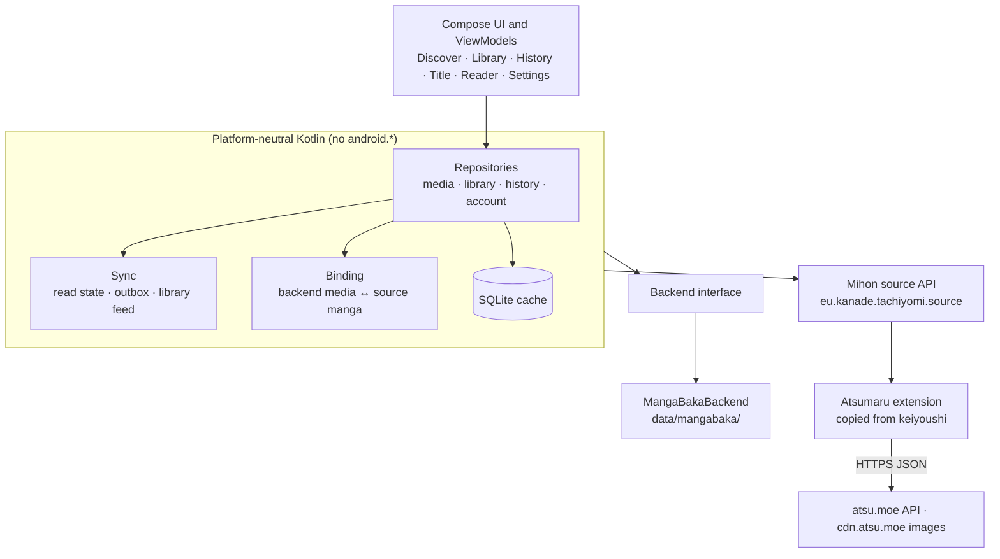

# Koma

## Why

Mihon is a full reader, but its library is local and trackers are attached afterwards: finding
something to read happens elsewhere, and the tracker is a sync target bolted onto each entry. Koma
inverts that. Koma is a client of one backend, MangaBaka, and that backend is the product surface:
the account, the library and the reading history are MangaBaka's. Discovery comes from MangaBaka's
trending, top-rated and popular lists, with its cross-site rating shown everywhere. Sources only
supply chapters and pages, through Mihon's extension API, so Mihon's extensions can supply them. v1
has one, Atsumaru, an aggregator whose titles carry their MangaBaka id. Reading a chapter updates
MangaBaka without a manual step. Koma is a personal Android app in Kotlin and Jetpack Compose.

- `[G-1]` Discover manga, manhwa and manhua from the backend's trending, top-rated and popular
  lists, with the backend's score on every card and title screen.
- `[G-2]` Read chapters from Atsumaru, found for a backend title without a manual search.
- `[G-3]` Mark chapters read automatically, in both directions, with the backend as the source of
  truth for progress.
- ~~`[G-5]` Keep the tracker and each content source behind interfaces, so another tracker or
  source can be added without touching the UI.~~
- `[G-5.1]` Keep the backend behind one interface and sources behind Mihon's extension API, so
  another backend can replace MangaBaka, or another source be added, without touching the UI.
- `[NG-1]` iOS, macOS, web, Linux and Windows builds in v1. Android is the only shipped host.
- `[NG-2]` A local library or local-only titles. A title exists in the app only through the
  backend library or a backend query.
- ~~`[NG-3]` Mihon interoperability: extensions, repositories and backups.~~
- `[NG-3.1]` Mihon interoperability beyond the source API in v1: installing extension APKs,
  extension repositories, and backups.
- `[NG-4]` Offline chapter downloads and background library updates with notifications.
- `[NG-5]` More than one active backend at a time.
- `[NG-6]` Anime, light novels, or any non-image content.
- `[NG-7]` Migrating an existing AniList list. MangaBaka's own AniList import does that once,
  outside Koma.

## Design

- `[PI-1]` Backend first. Every screen starts from a backend media; a source manga exists only as
  the content behind a backend media.
- ~~`[PI-2]` Platform-neutral core. Everything above the `Source` and `Tracker` interfaces is
  TypeScript in the Exact data module and must not know it runs on Android, which site a source
  reads, or that the tracker is MangaBaka.~~
- ~~`[PI-2.1]` Platform-neutral core. Everything above the `Source` and `Tracker` interfaces is
  Kotlin that imports no `android.*`, and must not know which site a source reads or that the
  tracker is MangaBaka.~~
- `[PI-2.2]` Platform-neutral core. Everything above the `Backend` interface and Mihon's source API
  is Kotlin that imports no `android.*`. It must not know which site a source reads or that the
  backend is MangaBaka.
- `[PI-3]` The backend owns progress. Local state may cache or queue progress, never contradict it.
- `[PI-4]` Repositories own the data. Screens and ViewModels read and write only through
  repositories. A ViewModel holds only its screen's status, such as a request in flight or failed,
  and builds state with pure functions.

| Decision | Choice | Rationale |
| --- | --- | --- |
| ~~`[KD-1]` Framework~~ | ~~Expo Exact: view in `app.contract`, logic in `app.ts` and `src/**/*.ts`, SQLite through Exact storage grants~~ | ~~Personal app; instability accepted. Pin one `expo/exact` commit and upgrade deliberately.~~ |
| `[KD-1.1]` Framework | Native Android: Kotlin and Jetpack Compose in one Gradle module, `app/`, with SQLite through SQLDelight | Android is the only host (`[KD-2.1]`), and Gradle builds it with no Rust, Hermes or wasm toolchain. |
| ~~`[KD-2]` Host~~ | ~~Android only (`[NG-1]`)~~ | ~~Scope choice for a personal app. Nothing in the design depends on Android.~~ |
| `[KD-2.1]` Host | Android only (`[NG-1]`) | Scope choice for a personal app. Only the UI and the platform seams depend on Android (`[PI-2.2]`). |
| `[KD-4]` Backend v1 | MangaBaka REST API (`https://api.mangabaka.org`) | Cross-site rating, decimal chapter progress, a library changes feed, and lookups from AniList, MyAnimeList and Kitsu ids. |
| ~~`[KD-5]` Sign-in~~ | ~~OAuth authorization code with PKCE (S256) as a public client, through `openAuthSession` with the custom-scheme callback `koma://auth`. Scopes `openid library.read library.write offline_access`. Tokens kept with `secret.keep`.~~ | ~~Exact's Android `openAuthSession` supports custom schemes only; Mihon's MangaBaka tracker uses the same flow. MangaBaka rejects every token without `openid`.~~ |
| `[KD-5.1]` Sign-in | OAuth authorization code with PKCE (S256) as a public client: Koma's own client on OkHttp, opening a Custom Tab, with the custom-scheme callback `koma://auth`. Scopes `openid library.read library.write offline_access`. Tokens kept by `KeystoreSecretStore`, encrypted by an AES-256-GCM key held in the Android Keystore. | AppAuth-Android has had no release since 2022, and the flow is small enough to test on the JVM. Mihon's MangaBaka tracker uses the same flow. MangaBaka rejects every token without `openid`. |
| `[KD-6]` Token refresh | Access tokens last 7 days. Each refresh returns a new refresh token, which replaces the stored one before the new access token is used. | MangaBaka revokes every token of the app for that user when a retired refresh token is sent. |
| `[KD-7]` Endpoint stability | Stable `v1` endpoints for search, feeds, series batches and library writes. Two beta endpoints: the `v2` changes feed for library sync, and `v1` series collections for reading direction. | Each MangaBaka endpoint declares its own stability. Neither beta endpoint has a stable equivalent. A failed collections read falls back to `[CT-9.2]`'s kind default. |
| ~~`[KD-8]` Library~~ | ~~The tracker library grouped by status, cached in SQLite. Read whole once, then kept current from the changes feed with a stored cursor. A refused cursor triggers one full read.~~ | ~~`[NG-2]`. The feed carries removals, so the cache never keeps a deleted entry.~~ |
| `[KD-8.1]` Library | The backend library grouped by status, cached in SQLite. Read whole once through `changes(null)`, then kept current with a stored cursor. A refused cursor (`ExpiredCursorException`) triggers one full read. A backend without a changes feed refuses every cursor. | `[NG-2]`. The feed carries removals, so the cache never keeps a deleted entry. One member serves backends with and without a feed. |
| `[KD-9]` Public reads | Public endpoints (search, feeds, series) are called without credentials. | MangaBaka's CDN caches only unauthenticated GETs, and a cache hit does not count against the rate limit (`[C-4]`). |
| `[KD-10]` Merged series | A series answering `state: merged` has its id replaced by `merged_with` in every local row that stores it | MangaBaka merges duplicate series; an old id stops receiving updates. |
| ~~`[KD-11]` Title to source binding~~ | ~~On first read, try the user's ordered preferred sources. A source with `find` binds only what `find` answers. A source without it is searched with every tracker title variant and binds on an exact normalized title match. When no source binds, the title screen shows ranked search candidates from every source. The binding is editable from the title screen.~~ | ~~A tracker id proves the match, so a same-titled novel or edition never binds. Title matching stays for sources without ids.~~ |
| `[KD-11.1]` Title to source binding | On first read, try the user's ordered preferred sources. A source with a `Finder` binds only what its finder answers. A source without one is searched with every backend title variant and binds on an exact normalized title match. When no source binds, the title screen shows ranked search candidates from every source. The binding is editable from the title screen. | A backend id proves the match, so a same-titled novel or edition never binds. Title matching stays for sources without ids. Finders live in Koma, so copied extensions stay as upstream ships them. |
| `[KD-13]` Read state | Derived, never stored: see `[CT-5.1]` | `[PI-3]`. A stored flag would contradict the backend after an edit on mangabaka.org. |
| `[KD-14]` Progress writes | Queued in a SQLite outbox, coalesced per media to the max, flushed immediately and on every launch or foreground | Reading must not block on the network. |
| ~~`[KD-15]` Page images~~ | ~~`pages` answers URLs the view loads directly. A source whose images need headers or descrambling downloads them into `app:/cache/pages/…` and answers those paths.~~ | ~~Atsumaru's CDN serves pages without headers. Exact's Android host downloads remote `img` sources itself.~~ |
| ~~`[KD-15.1]` Page images~~ | ~~`pages` answers page URLs, which Coil loads with the request headers the source gives. A source whose images need descrambling downloads them into the app's cache and answers those files.~~ | ~~Atsumaru's CDN serves pages without headers. Coil caches pages on disk and takes headers per request.~~ |
| `[KD-15.2]` Page images | Coil loads each page through the source's `HttpSource.getImage(page)`, after `getImageUrl(page)` when the page has no `imageUrl`. The source's client, headers and interceptors apply. | Mihon's extensions put headers, rate limits and descrambling in their OkHttp client, so loading through it keeps them working unchanged. Coil caches pages on disk. |
| ~~`[KD-16]` Reader~~ | ~~Three modes: a vertical long strip, paged left to right, and paged right to left. Each is a virtualized list: vertical for the strip, horizontal when paged, with `scroll-snap-type="x mandatory"` and one page per snap area at `scroll-snap-stop="always"`. The reader opens at `[CT-9]`'s mode, and the user can change it per title.~~ | ~~The series type alone misplaces titles: The Breaker is manhwa but paged. Exact's row lists virtualize and snap on Android.~~ |
| `[KD-16.1]` Reader | Three modes: a vertical long strip, paged left to right, and paged right to left. The strip is a `LazyColumn`. Paged modes are a `HorizontalPager`, with `reverseLayout` for right to left. The reader opens at `[CT-9.2]`'s mode, and the user can change it per title. | The series type alone misplaces titles: The Breaker is manhwa but paged. Both layouts virtualize, and the pager snaps one page at a time. |
| ~~`[KD-18]` Sources~~ | ~~A static catalog: one TypeScript module per source in `src/sources/`, listed in `src/sources/index.ts`. v1 lists Atsumaru only.~~ | ~~Atsumaru's JSON API answers plain HTTPS with no Cloudflare challenge, and its 33,632 series (2026-11-18) cover the titles the user reads.~~ |
| ~~`[KD-18.1]` Sources~~ | ~~A static catalog: one Kotlin class per source in `app/src/main/kotlin/app/koma/source/`, listed in that package's `Sources.kt`. v1 lists Atsumaru only.~~ | ~~Atsumaru's JSON API answers plain HTTPS with no Cloudflare challenge, and its 33,632 series (2026-11-18) cover the titles the user reads.~~ |
| `[KD-18.2]` Sources | Mihon's extension API, at the version keiyoushi's extensions build against. Koma ships the `eu.kanade.tachiyomi.source` and `eu.kanade.tachiyomi.network` packages, and the keiyoushi helper packages a copied extension imports. v1 copies the extensions it uses from `keiyoushi/extensions-source` into `app/src/main/kotlin/eu/kanade/tachiyomi/extension/`, and lists them in `app/src/main/kotlin/app/koma/source/Sources.kt`. v1 lists Atsumaru only. | A copied extension builds with few or no edits and stays comparable with upstream. The same API can later load installed extension APKs (`[NG-3.1]`). Atsumaru's JSON API answers plain HTTPS with no Cloudflare challenge, and its 33,632 series (2026-11-18) cover the titles the user reads. |
| ~~`[KD-19]` Chapter deduplication~~ | ~~Atsumaru lists one upload per scanlator. Its adapter keeps one chapter per number: the upload whose scanlator has the highest `score`, then the latest upload.~~ | ~~Same rule as keiyoushi's Atsumaru extension.~~ |
| `[KD-19.1]` Chapter deduplication | The source's own. Atsumaru lists one upload per scanlator, and the copied extension keeps one chapter per number: the upload whose scanlator has the highest `score`, then the latest upload. | Mihon's `SChapter` carries no scanlator score, so only the extension can rank uploads. |
| `[KD-20]` Backend | One interface, `Backend` (`[CT-1.4]`). MangaBaka implements it as `MangaBakaBackend` in `app.koma.data.mangabaka`, with its sign-in. `KomaApplication` builds it and passes it to `AppContainer`; nothing else imports that package. | Koma is built as a client of this service, so "tracker", Mihon's word for a sync target added afterwards, misnames it. A name ending in `Service` would be confused with Android's component. One interface, not one per capability: `[NG-5]` allows one backend at a time, and library entries reference the backend's own media ids. |
| `[KD-21]` Repositories | `MediaRepository`, `LibraryRepository`, `HistoryRepository` and `AccountRepository` in `app.koma.data`, one instance each, built by `AppContainer` (`[CT-10.1]`). Library and history sync run inside them. | Android's data-layer guidance: one repository per kind of data, over the network and the database. Any screen reuses the same data. |
| `[KD-22]` Backend name in copy | UI strings that name the backend read `Backend.name`. | Replacing the backend touches no screen. |
| `[KD-23]` Rating | The title screen's status button splits once the library holds the title: its trailing half shows the user's rating and opens a gauge from 0 to 5 in half points. 0 clears the rating. | MangaBaka rates out of 100 and stores 0 as none. Half points keep a drag along the gauge's arc precise. |
| `[KD-24]` Navigation | Navigation 3. Each tab keeps its own back stack of `@Serializable` routes, restored after process death. Another tab's stack shows over the Library's, so back from its root opens the Library, and back from the Library's root leaves the app. Each screen draws its own floating header. | Popped screens drop their ViewModels and saved state, and predictive back works at any depth. A shared header would need its own copy of `NavDisplay`'s transition. |
| `[KD-25]` Title colors | A title screen, its header included, takes a Material "Content" scheme seeded by its cover's most suitable color (MaterialKolor's `material-color-utilities`: Celebi quantizer, then `Score`). The colors ease in once the cover loads. A grey cover, or the Monochrome style, keeps the app's colors; True Black still applies. | The Content scheme is what Android builds from album art, so the cover itself sits on its own colors. A seed read from a 96 px copy costs little after the grid has cached the cover. |



## Outcome

- `[SO-1]` The Discover tab lists MangaBaka trending, top-rated and popular titles, filterable by
  manga, manhwa and manhua, each card showing the MangaBaka rating. — demonstrated by `[VC-1.1]`
- `[SO-2]` The Library tab is the signed-in user's MangaBaka library, grouped by status, and follows
  edits and removals made elsewhere. — demonstrated by `[VC-1.1]`, `[VC-8]`
- `[SO-3]` A user can open a MangaBaka title and read it from Atsumaru without searching, when
  Atsumaru carries that title's MangaBaka id. Each chapter number appears once. — demonstrated by
  `[VC-3]`, `[VC-12.1]`, `[VC-13]`
- `[SO-4]` Finishing a chapter raises MangaBaka progress without user action, and a chapter list
  shows as read every chapter the progress covers, decimal chapters included. — demonstrated by
  `[VC-4]`, `[VC-5]`
- ~~`[SO-6]` UI and sync code run unchanged against any `Tracker` and `Source` implementation.
  — demonstrated by `[VC-7]`~~
- `[SO-6.1]` UI, repositories and sync run unchanged against any `Backend` and any source built on
  Mihon's extension API, including the backend's name in copy. — demonstrated by `[VC-7.1]`
- `[SO-7]` The reader opens a long-strip title as a vertical strip and any other title paged, in the
  direction the backend gives, else right to left for manga and left to right otherwise. The user
  can override the mode per title. — demonstrated by `[VC-11]`
- `[SO-8]` A user rates a library title from its screen, in half points from 0.5 to 5, or clears
  the rating. The rating is MangaBaka's and follows edits made elsewhere. — demonstrated by
  `[VC-14]`

## Contracts

### [CT-1.4] Backend

Kind: api · Anchor: null

~~`[CT-1]` Tracker, as TypeScript~~ and ~~`[CT-1.1]` Tracker~~: renamed `Backend` (`[KD-20]`). It
adds the account, details and history members, and `changes(null)` replaces `list()` (`[KD-8.1]`).
~~`[CT-1.2]` Backend~~: scores move from integers on 0–100 to one decimal on 0.0–5.0.
~~`[CT-1.3]` Backend~~: an `updateEntry` score of 0 clears the rating, and MangaBaka maps the user's
rating both ways.

```kotlin
package app.koma.data

enum class BackendId { MangaBaka }
data class MediaRef(val backend: BackendId, val id: String)
enum class Kind { Manga, Manhwa, Manhua, Oel, Novel, Other }
enum class ListStatus { Reading, Planning, Considering, Completed, Paused, Dropped, Rereading }
enum class Publication { Releasing, Completed, Hiatus, Cancelled, Upcoming, Unknown }
enum class ReadingDirection { Ltr, Rtl }

/** What a card, a shelf or a history row shows. */
data class Media(
    val ref: MediaRef,
    val title: String,               // display title
    val cover: String,
    val kind: Kind,
    val score: Double?,              // backend rating, 0.0–5.0, one decimal
    val adult: Boolean,
    val longStrip: Boolean,          // false when the backend does not say
)

/** What the title screen shows beyond [media]. */
data class MediaDetails(
    val media: Media,
    val titles: List<String>,        // every variant: native, romanized, secondary titles
    val authors: List<String>,
    val publication: Publication,
    val startYear: Int?,
    val chapters: Double?,           // total, when the backend knows it
    val description: String,
    val tags: List<Tag>,
)
data class Tag(val name: String, val genre: Boolean, val spoiler: Boolean, val rank: Int?) // rank 0–100

data class ListEntry(
    val ref: MediaRef,
    val status: ListStatus,
    val progress: Double?,           // chapters read; may be fractional
    val score: Double?,              // the user's rating, 0.0–5.0, one decimal
    val updatedAt: Long,             // epoch ms
)
sealed interface ListChange {
    data class Upsert(val entry: ListEntry) : ListChange
    data class Removed(val ref: MediaRef) : ListChange
}
data class ReadEvent(val id: String, val ref: MediaRef, val at: Long, val from: Double?, val to: Double?)

enum class Feed { Trending, Top, Popular }
data class Filters(val kinds: Set<Kind>? = null, val genres: List<String>? = null, val adult: Boolean? = null)
data class Paged<T>(val items: List<T>, val hasNext: Boolean)
data class CursorPage<T>(val items: List<T>, val cursor: String, val more: Boolean)

data class Session(val signedIn: Boolean, val error: String)
data class SignInResult(val ok: Boolean, val error: String)
class SignedOutException : IOException("Not signed in.")
class ExpiredCursorException : IOException("Cursor refused.")

interface Backend {
    val id: BackendId
    val name: String                                               // shown in copy (`[KD-22]`)
    val sessions: StateFlow<Session>
    suspend fun signIn(): SignInResult
    suspend fun signOut()
    suspend fun userName(): String                                 // empty when the account has none
    suspend fun changes(cursor: String?): CursorPage<ListChange>
    suspend fun entry(ref: MediaRef): ListEntry?
    suspend fun addEntry(ref: MediaRef, status: ListStatus, progress: Double? = null, score: Double? = null)
    suspend fun updateEntry(
        ref: MediaRef,
        status: ListStatus? = null,
        progress: Double? = null,
        score: Double? = null,
    )
    suspend fun readEvents(cursor: String?, since: Long?, limit: Int): CursorPage<ReadEvent>
    suspend fun media(refs: List<MediaRef>): List<Media>
    suspend fun details(ref: MediaRef): MediaDetails
    suspend fun search(query: String, filters: Filters, page: Int): Paged<Media>
    suspend fun discover(feed: Feed, filters: Filters, page: Int): Paged<Media>? = null // null: no such feed
    suspend fun readingDirection(ref: MediaRef): ReadingDirection? = null
}
```

Every member throws an `IOException` for any failure, an unreadable reply included, so callers never
see HTTP statuses or serialization. `changes(null)` pages through the whole library; a refused
cursor throws `ExpiredCursorException`. A cursor is stored only after its page is applied.
`addEntry` puts media in the library; `updateEntry` changes only the fields it is given, and a
`score` of 0 clears the rating. Either throws an `IOException` when the library already holds the
entry, or does not hold it, as the call assumed. A backend whose API only upserts implements both
the same way.
`media` accepts any number of refs; a ref the backend no longer answers is missing
from the result. `readEvents` answers newest first; `since` keeps events at or after that instant
(epoch ms), and a cursor is valid only with the filters that made it. `discover` answers null when
the backend has no such feed; the Discover tab hides it. `readingDirection` answers null when the
backend does not know: the reader then uses `[CT-9.2]`'s kind default. Every score, the backend's
and the user's, is on one 0.0–5.0 scale to one decimal, and tag ranks on 0–100, so no screen formats a
backend-specific scale.

MangaBaka mapping (`MangaBakaBackend`):

| Backend | MangaBaka |
| --- | --- |
| `MediaRef.id` | The series id, as a decimal string |
| `ListStatus` | `state`; `Planning` is `plan_to_read`, the others their lowercase names. An entry with an unknown `state` is skipped. |
| `Kind` | The series `type`: `manga`, `manhwa`, `manhua`, `oel`, `novel`; any other is `Other` |
| `Publication` | `status`; any value outside the enum is `Unknown` |
| `Media.score` | `rating` (0–100) divided by 20, rounded to one decimal |
| `ListEntry.score` | The entry's `rating`, scaled as `Media.score` |
| `Media.adult` | `content_rating` of `erotica` or `pornographic` |
| `Media.longStrip` | `tags_v2` holds tag 93 (`Work Info > Page Layout > Longstrip`) |
| `MediaDetails.tags` | Genres (`is_genre`) and tags weighted `core`; the others are dropped |
| `Tag.rank` | `weight`: `core` 100, `defining` 75, `recurrent` 50, `incidental` 25, `unweighted` null |
| `media` | `GET /v2/series/batch`, 50 ids per call, unauthenticated |
| `details` | `GET /v2/series/{id}?schema=full`, unauthenticated |
| `search`, `discover` | `GET /v1/series/search`, `discover` with `sort_by` `trending_7d`, `score_desc` or `popularity_desc`; `type_not=novel` on every call (`[NG-6]`) |
| `changes` | `GET /v2/my/library/changes?limit=1000`; a 400 to a request with a cursor throws `ExpiredCursorException`. Lists and unknown item kinds are skipped. |
| `addEntry`, `updateEntry` | `POST` and `PATCH /v1/my/library/{id}`, sending `state`, `progress_chapter` and `rating`, the score times 20 rounded to an integer; MangaBaka stores a `rating` of 0 as none |
| `readEvents` | `GET /v2/my/library/events?event_type=progress_update`; undated events are dropped |
| `userName` | `GET /v1/my/profile`: `preferred_username`, else `nickname`, else empty |
| `readingDirection` | `GET /v1/series/{id}/collections`: the `reading` of the first collection whose language is the series' `original_language`, else of the first collection, else `null` |

### [CT-2.2] Sources

Kind: api · Anchor: null

~~`[CT-2]` Source, as TypeScript~~ and ~~`[CT-2.1]` Source~~: replaced by Mihon's source API
(`[KD-18.2]`). Koma's own side is the finder and the catalog.

```kotlin
// Mihon's API, eu.kanade.tachiyomi.source: the members Koma calls.
interface Source {
    val id: Long
    val name: String
    val lang: String
    suspend fun getSearchManga(page: Int, query: String, filters: FilterList): MangasPage
    suspend fun getMangaUpdate(
        manga: SManga, chapters: List<SChapter>, fetchDetails: Boolean, fetchChapters: Boolean,
    ): SMangaUpdate
    suspend fun getPageList(chapter: SChapter): List<Page>
}
abstract class HttpSource : CatalogueSource {
    open val client: OkHttpClient
    open suspend fun getImageUrl(page: Page): String
    suspend fun getImage(page: Page, existingSize: Long = 0L): Response
}

// Koma, app/src/main/kotlin/app/koma/source/
/** Proves that a source manga is a backend media. */
fun interface Finder {
    suspend fun find(details: MediaDetails): SManga?
}
class CatalogSource(val source: HttpSource, val finder: Finder? = null)
val sources: List<CatalogSource>     // Sources.kt
```

`SManga.url` and `SChapter.url` are the source's keys and opaque to the core; a binding stores
`Source.id` and `SManga.url`. Chapters are `getMangaUpdate(manga, emptyList(), fetchDetails =
false, fetchChapters = true).chapters`. Koma never calls the deprecated Rx members. `find` answers
a manga only when the source proves it is that media, for example by a backend id; `null` means
unproven (`[KD-11.1]`). A source never writes to the backend or the store.

`AppContainer` registers Mihon's `NetworkHelper` in Injekt, its client built from
`AppContainer.http`, so every source request passes through the same seam as the app's.

Atsumaru finder: defined for MangaBaka media only. It searches each title variant through
`getSearchManga`, reads `GET https://atsu.moe/api/manga/page?id={SManga.url}` through the source's
`client` for the top three hits not yet read, and answers the first whose `mangaBakaId` equals
`media.ref.id`.

### [CT-4.3] Local store

Kind: schema · Anchor: null

~~`[CT-4]` Local store~~: reconciled with the shipped tables, keyed by `MediaRef`.
~~`[CT-4.1]` Local store~~: `media.score` holds `[CT-1.3]`'s 0.0–5.0 scale.
~~`[CT-4.2]` Local store~~: `library_entry.score` holds the user's rating.

```sql
create table media (
  backend text not null, id text not null,
  title text not null, cover text not null, kind text not null,
  score real, adult integer not null, long_strip integer not null,
  primary key (backend, id)
);
create table library_entry (
  backend text not null, media_id text not null,
  status text not null, progress real, updated_at integer not null, score real,
  primary key (backend, media_id)
);
create table read_event (
  backend text not null, id text not null, media_id text not null,
  at integer not null, from_chapter real, to_chapter real,
  primary key (backend, id)
);
create index read_event_at on read_event (at desc, id desc);
create table meta (key text primary key, value text not null);
create table binding (
  backend text not null, media_id text not null,
  source integer not null, manga_url text not null, title text not null,
  primary key (backend, media_id)
);
create table preferred_source (source integer primary key, position integer not null);
create table progress_outbox (
  backend text not null, media_id text not null,
  progress real not null, status text, queued_at integer not null,
  primary key (backend, media_id)
);
create table reader_position (
  source integer not null, chapter_url text not null, page integer not null,
  primary key (source, chapter_url)
);
create table reading_mode (
  backend text not null, media_id text not null, mode text not null,
  primary key (backend, media_id)
);
create table cache (key text primary key, json text not null, fetched_at integer not null);
```

`status`, `kind` and `mode` hold enum names; `source` is Mihon's `Source.id`. The store holds no
read flags (`[KD-13]`). `media` is public data kept across sign-outs; an empty `title` marks media
the backend no longer answers, which screens leave out. `library_entry` mirrors the backend library
and changes only through `changes()` or a successful `addEntry` or `updateEntry`. `meta` holds the library and
history cursors and is cleared at sign-out with `library_entry` and `read_event`. `cache` holds
details, feed pages and reading directions so the app opens offline. `[KD-10]` rewrites `media_id`
in `binding`, `library_entry`, `progress_outbox` and `reading_mode`. A migration converts stored
scores to the 0.0–5.0 scale. `library_entry.score` is null when the user has not rated the media.
The migration that adds it drops the library cursor, so the next sync reads the library whole and
fills it in.

### [CT-5.1] Read state

Kind: invariant · Anchor: null

~~`[CT-5]` Read state, as TypeScript~~: the same rule, over Mihon's `SChapter`.

```kotlin
val effectiveProgress = maxOf(entry?.progress ?: 0.0, outbox?.progress ?: 0.0)
fun number(c: SChapter): Double? = c.chapter_number.takeIf { it >= 0f }?.toString()?.toDouble()
fun isRead(c: SChapter): Boolean = number(c)?.let { it <= effectiveProgress } ?: false
```

Chapter numbers compare exactly: progress 4 leaves chapter 4.5 unread. Mihon gives `-1` for a
chapter with no number, which is never shown read and never moves progress. The `Float` goes
through its decimal string, so chapter `10.1f` equals progress `10.1`.

### [CT-6.1] Progress push

Kind: invariant · Anchor: null

~~`[CT-6]` Progress push~~: the same flush, over `[CT-1.3]`'s members and status names.

A chapter is finished when its last page has been on screen. Finishing chapter `c` with
`n = number(c)` and `n > effectiveProgress` upserts the outbox row to `n`. Flushing a row:

1. Read `backend.entry(ref)`. If its progress ≥ queued progress, delete the row and stop.
2. Status: no entry, `Planning`, `Considering`, `Paused` or `Dropped` becomes `Reading`; `Reading`
   and `Rereading` stay. When `MediaDetails.chapters` is known and `n ≥ chapters`, a `Reading`
   status becomes `Completed`. An entry already `Completed` is never written.
3. `addEntry(ref, status, progress = n)` when there was no entry, else
   `updateEntry(ref, status, progress = n)`, then delete the row.

Progress never decreases through the app. A failed flush keeps the row for the next flush.

### [CT-9.2] Reading mode

Kind: invariant · Anchor: null

~~`[CT-9]` Reading mode, as TypeScript~~ and ~~`[CT-9.1]` Reading mode~~: the same rule, asking
the `Backend`.

```kotlin
enum class ReadingMode { LongStrip, PagedLtr, PagedRtl }

val direction = try { backend.readingDirection(media.ref) } catch (e: IOException) { null }
val mode = readingMode?.mode
    ?: when {
        media.longStrip -> ReadingMode.LongStrip
        (direction ?: if (media.kind == Kind.Manga) ReadingDirection.Rtl else ReadingDirection.Ltr) ==
            ReadingDirection.Rtl -> ReadingMode.PagedRtl
        else -> ReadingMode.PagedLtr
    }
```

`readingMode` is the title's `reading_mode` row, written only by the user's choice. `direction` is
read when a title that is not a long strip first opens, and kept in `cache`. Paged right to left
shows the first page at the right and advances leftward. Changing the mode keeps the current page.

### [CT-10.1] Repositories

Kind: api · Anchor: null

~~`[CT-10]` Repositories~~: `entry` replaces `status`, and `setScore` rates a title.

```kotlin
package app.koma.data

class MediaRepository(store: Store, backend: Backend) {
    fun media(ref: MediaRef): Flow<Media?>                         // from the store
    suspend fun details(ref: MediaRef): MediaDetails
    suspend fun cache(refs: Collection<MediaRef>)                  // looks up refs not stored yet
}

data class LibraryItem(val media: Media, val status: ListStatus, val updatedAt: Long)
data class Library(val synced: Boolean, val items: List<LibraryItem>)

class LibraryRepository(store: Store, backend: Backend, media: MediaRepository, clock: Clock) {
    val library: Flow<Library>
    fun entry(ref: MediaRef): Flow<ListEntry?>
    suspend fun sync()
    suspend fun setStatus(ref: MediaRef, status: ListStatus)
    suspend fun setScore(ref: MediaRef, score: Double)          // 0 clears the rating
}

data class Read(val id: String, val media: Media, val at: Long, val from: Double?, val to: Double)
data class History(val synced: Boolean, val reads: List<Read>, val hasNext: Boolean)

class HistoryRepository(store: Store, backend: Backend, media: MediaRepository) {
    val history: Flow<History>
    suspend fun syncNewer()
    suspend fun loadOlder()
}

class AccountRepository(store: Store, backend: Backend) {
    val backendName: String
    val sessions: StateFlow<Session>
    val signIns: Int                 // successful sign-ins in this process
    val userName: StateFlow<String?> // null until loaded; empty when the account has none
    suspend fun signIn(): SignInResult
    suspend fun signOut()
    suspend fun loadUserName()
}
```

`AppContainer` builds one of each from the `Backend` it is given, and exposes no `Store`, SQL or
`Backend` to features. Flows answer again after each store write. `Library.items` and
`History.reads` leave out media the backend no longer answers; `History.reads` holds only events
that raise progress. Grouping into shelves and hiding `Kind.Novel` are the library feature's pure
functions. A sync or write started before a sign-out drops what it fetched (`Store.generation`).
`setStatus` calls `addEntry` when the stored library lacks the media, else `updateEntry`, then
writes the store. When that call fails, it syncs the library, so a retry picks the member that
matches the backend. `setScore` calls `updateEntry(ref, score = score)` on media the library
holds, then writes the store, and syncs the same way when that call fails. `signOut` clears user
data before ending the session. `loadUserName` asks once per session and drops a reply for a
session that has ended.

## Acceptance

Tests run on the JVM under Robolectric. Backend tests stub MangaBaka's API and OAuth endpoints with
`FakeNetwork`, the test harness's OkHttp interceptor, and source tests stub Atsumaru's API the same
way, through the client sources share (`[CT-2.2]`). The harness records the image URLs the app asks for and loads none.

- ~~`[VC-1]` Given a stub returning distinct `trending_7d`, `score_desc` and library payloads, when
  the Discover and Library tabs open, then each shows the stub's titles in the stub's order, the
  manhwa filter sends `type=manhwa`, every search sends `type_not=novel`, a card shows `84` for
  `rating: 84`, Discover requests carry no `Authorization` header, and Library groups match the
  stub's states. — demonstrates `[SO-1]`, `[SO-2]`~~
- `[VC-1.1]` Given a stub returning distinct `trending_7d`, `score_desc` and library payloads, when
  the Discover and Library tabs open, then each shows the stub's titles in the stub's order, the
  manhwa filter sends `type=manhwa`, every search sends `type_not=novel`, a card shows `4.2` for
  `rating: 84`, Discover requests carry no `Authorization` header, and Library groups match the
  stub's states. — demonstrates `[SO-1]`, `[SO-2]`
- `[VC-3]` Given a title bound to the Atsumaru stub, when a chapter whose stubbed page list holds
  three images opens in the reader, then the reader shows those three images, loaded from the
  stub's `/static/pages/…` URLs. — demonstrates `[SO-3]`
- `[VC-4]` Given remote progress 4 and stubbed chapters 1, 2, 4, 4.5, 5 and one without a number,
  when the chapter list opens, then 1, 2 and 4 show read, and 4.5, 5 and the unnumbered one show
  unread. — demonstrates `[SO-4]`
- `[VC-5]` Given remote progress 4 with state `plan_to_read`, when chapter 4.5's last page is shown,
  then the stub receives `PATCH /v1/my/library/{id}` with `progress_chapter: 4.5` and
  `state: "reading"`; given no entry, it receives `POST` instead; when chapter 3 is finished
  instead, the stub receives no write; when the stub is offline, the write arrives on the next
  launch. — demonstrates `[SO-4]`
- ~~`[VC-7]` Given test `Tracker` and `Source` implementations with ids and titles that MangaBaka
  and Atsumaru could not produce, when the Discover, Library, title-screen and sync tests
  run against them, then they show and push the stubs' values. — demonstrates `[SO-6]`~~
- `[VC-7.1]` Given a test `Backend` named `Shelfie` and a test `HttpSource`, with ids and titles
  that MangaBaka and Atsumaru could not produce, when the Discover, Library, History, title-screen,
  Settings, reader and sync tests run against them, then they show and push the stubs' values, and
  every screen that names the backend reads `Shelfie`. — demonstrates `[SO-6.1]`
- `[VC-8]` Given a synced library and a stored cursor, when the changes feed answers one upsert and
  one delete with `more: true` and then `more: false`, then Library shows the upsert, drops the
  deleted entry, issues no full library read, and stores the last cursor; when the stub refuses the
  cursor, one full read follows. — demonstrates `[SO-2]`
- `[VC-9]` Given an expired access token, when the app refreshes twice, then the second refresh
  sends the refresh token the first one returned.
- `[VC-10]` Given a binding and an outbox row for series `5`, when the stub answers series `5` with
  `state: merged` and `merged_with: 9`, then both rows move to `9` and the next progress write
  targets `/v1/my/library/9`.
- `[VC-11]` Given stub series A tagged Longstrip, B a manhwa with no tag and no collection, C a
  manhwa whose only collection reads `rtl`, and D a manga with no collection, when each opens in
  the reader, then A is a long strip, B is paged left to right, and C and D are paged right to
  left; after the user switches B to long strip, B reopens as a long strip; when the collections
  endpoint answers 500, C opens paged left to right. — demonstrates `[SO-7]`
- ~~`[VC-12]` Given media `3397` titled `Solo Leveling` with variant `Na Honjaman Level Up`, and an
  Atsumaru stub whose search answers `A` titled `Solo Leveling` with `mangaBakaId` `1`, then `B`
  titled `I Level Up Alone` with `mangaBakaId` `3397`, when the title is first read, then it binds
  to `B` without a prompt and every search sent `filter_by` holding `medium:=Comic`; when neither
  hit carries `3397`, nothing is bound and the title screen lists `A` and `B` as candidates.
  — demonstrates `[SO-3]`~~
- `[VC-12.1]` Given media `3397` titled `Solo Leveling` with variant `Na Honjaman Level Up`, and
  an Atsumaru stub whose search answers `A` titled `Solo Leveling` with `mangaBakaId` `1`, then `B`
  titled `I Level Up Alone` with `mangaBakaId` `3397`, when the title is first read, then the
  Atsumaru finder binds it to `B` without a prompt; when neither hit carries `3397`, nothing is
  bound and the title screen lists `A` and `B` as candidates. — demonstrates `[SO-3]`
- `[VC-13]` Given an Atsumaru stub listing chapter 5 from scanlator `Y` (score 3, day 1), `Z`
  (score 3, day 2) and `X` (score 1, day 3), and chapter 4.5 from `X` alone, when the chapter list
  opens, then it shows one chapter 5, credited to `Z`, and chapter 4.5, credited to `X`.
  — demonstrates `[SO-3]`
- `[VC-14]` Given a library entry with `rating: 87`, when its title screen opens, then the status
  button's rating half shows `4.4`; when the gauge moves to 3.5 and the rating is saved, the stub
  receives `PATCH /v1/my/library/{id}` with `rating: 70` and the half shows `3.5`; when the gauge
  moves to 0 instead, the stub receives `rating: 0` and the half offers to rate; when the stub
  answers 500, the half keeps the rating it showed. — demonstrates `[SO-8]`

## Caveats

- ~~`[C-1]` Exact is pre-1.0 with no API stability, and its Android host is early. The app pins one
  `expo/exact` commit; every upgrade is a deliberate change.~~
- `[C-1.1]` Library versions follow Mihon's `gradle/libs.versions.toml`, so a set Mihon builds with
  is known to work together. Libraries Mihon does not use take their latest stable release.
- ~~`[C-3]` A source behind a Cloudflare challenge needs a WebView, which TypeScript data code lacks.
  Adding one, such as Asura Scans or Weeb Central, needs a native Exact package.~~
- `[C-3.1]` A source behind a Cloudflare challenge, such as Asura Scans or Weeb Central, can pass it
  in a WebView, as Mihon's extensions do.
- `[C-4]` MangaBaka allows 30 requests per minute for search, which includes every Discover feed,
  and 180 for everything else, per client IP. CDN cache hits are not counted. A 429 is retried after
  its `Retry-After`. Feeds and media are read from `cache` before the network.
- `[C-6]` MangaBaka is a volunteer project. Library sync depends on its beta changes feed (`[KD-7]`),
  which may change without notice; `[VC-8]`'s full-read fallback is the recovery path. Series
  collections are beta too; their failure only loses the edition direction in `[CT-9.2]`.
- `[C-7]` A public OAuth client must be registered on mangabaka.org with the redirect `koma://auth`
  before sign-in works. Its client id ships in the app.
- `[C-8]` MangaBaka data is CC BY-NC-SA 4.0 and requires attribution. Settings links to MangaBaka
  and names its upstream providers.
- ~~`[C-9]` Exact has not run right-to-left layout on an Android device (its queue item #515). If a
  `direction="rtl"` list misbehaves there, paged right to left reverses the page order in a
  left-to-right list and opens at its end.~~
- ~~`[C-10]` Atsumaru's API is undocumented. The endpoints in `[CT-2.1]` are those keiyoushi's Atsumaru
  extension uses (`src/en/atsumaru/` in `keiyoushi/extensions-source`), the first reference when
  one breaks. On 2026-11-18 they answered plain HTTPS without a challenge.~~
- `[C-10.1]` Atsumaru's API is undocumented. The copied extension owns its endpoints; when one
  breaks, the fix is a fresh copy of `src/en/atsumaru/` from `keiyoushi/extensions-source`. The
  finder's manga page read is Koma's and follows the extension's. On 2026-11-18 the API answered
  plain HTTPS without a challenge.
- ~~`[C-11]` `find` misses a title whose Atsumaru page lacks `mangaBakaId`, or whose title variants
  rank it below the top three hits. Such a title is bound by hand from the candidates.~~
- `[C-11.1]` The Atsumaru finder misses a title whose Atsumaru page lacks `mangaBakaId`, or whose
  title variants rank it below the top three hits. Such a title is bound by hand from the
  candidates, which may include novels: the extension's search decides what it answers.
- `[C-12]` Koma's copy of Mihon's source API follows the `extensions-lib` commit that keiyoushi's
  `gradle/libs.versions.toml` pins (`tachiyomi-lib-v16`, `42255ee5fa` on 2026-11-25). An extension
  copied from a later upstream may need that copy updated first. Copied code keeps its Apache 2.0
  headers, and lint treats its warnings as errors like Koma's own.

## Open Questions

None.
