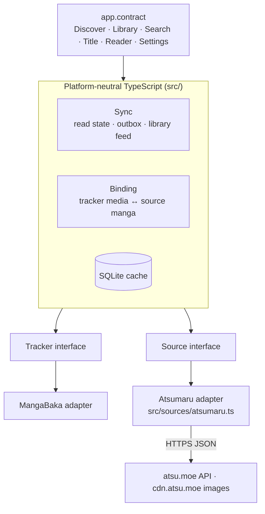

# Koma

## Why

Mihon is a full reader, but its library is local and trackers are attached afterwards: finding
something to read happens elsewhere, and the tracker is a sync target bolted onto each entry. Koma
inverts that. The tracker is the product surface. Discovery comes from MangaBaka's trending,
top-rated and popular lists, with its cross-site rating shown everywhere. The library is the
MangaBaka library itself. Sources only supply chapters and pages. v1 has one, Atsumaru, an
aggregator whose titles carry their MangaBaka id. Reading a chapter
updates MangaBaka without a manual step. Koma is a personal app built on Expo Exact, which is
pre-1.0 and unstable; that risk is accepted.

- `[G-1]` Discover manga, manhwa and manhua from the tracker's trending, top-rated and popular
  lists, with the tracker's score on every card and title screen.
- `[G-2]` Read chapters from Atsumaru, found for a tracker title without a manual search.
- `[G-3]` Mark chapters read automatically, in both directions, with the tracker as the source of
  truth for progress.
- `[G-5]` Keep the tracker and each content source behind interfaces, so another tracker or
  source can be added without touching the UI.
- `[NG-1]` iOS, macOS, web, Linux and Windows builds in v1. Android is the only shipped host.
- `[NG-2]` A local library or local-only titles. A title exists in the app only through the
  tracker library or a tracker query.
- `[NG-3]` Mihon interoperability: extensions, repositories and backups.
- `[NG-4]` Offline chapter downloads and background library updates with notifications.
- `[NG-5]` More than one active tracker at a time.
- `[NG-6]` Anime, light novels, or any non-image content.
- `[NG-7]` Migrating an existing AniList list. MangaBaka's own AniList import does that once,
  outside Koma.

## Design

- `[PI-1]` Tracker first. Every screen starts from a tracker media; a source manga exists only as
  the content behind a tracker media.
- `[PI-2]` Platform-neutral core. Everything above the `Source` and `Tracker` interfaces is
  TypeScript in the Exact data module and must not know it runs on Android, which site a source
  reads, or that the tracker is MangaBaka.
- `[PI-3]` The tracker owns progress. Local state may cache or queue progress, never contradict it.

| Decision | Choice | Rationale |
| --- | --- | --- |
| `[KD-1]` Framework | Expo Exact: view in `app.contract`, logic in `app.ts` and `src/**/*.ts`, SQLite through Exact storage grants | Personal app; instability accepted. Pin one `expo/exact` commit and upgrade deliberately. |
| `[KD-2]` Host | Android only (`[NG-1]`) | Scope choice for a personal app. Nothing in the design depends on Android. |
| `[KD-4]` Tracker v1 | MangaBaka REST API (`https://api.mangabaka.org`) | Cross-site rating, decimal chapter progress, a library changes feed, and lookups from AniList, MyAnimeList and Kitsu ids. |
| `[KD-5]` Sign-in | OAuth authorization code with PKCE (S256) as a public client, through `openAuthSession` with the custom-scheme callback `koma://auth`. Scopes `openid library.read library.write offline_access`. Tokens kept with `secret.keep`. | Exact's Android `openAuthSession` supports custom schemes only; Mihon's MangaBaka tracker uses the same flow. MangaBaka rejects every token without `openid`. |
| `[KD-6]` Token refresh | Access tokens last 7 days. Each refresh returns a new refresh token, which replaces the stored one before the new access token is used. | MangaBaka revokes every token of the app for that user when a retired refresh token is sent. |
| `[KD-7]` Endpoint stability | Stable `v1` endpoints for search, feeds, series batches and library writes. Two beta endpoints: the `v2` changes feed for library sync, and `v1` series collections for reading direction. | Each MangaBaka endpoint declares its own stability. Neither beta endpoint has a stable equivalent. A failed collections read falls back to `[CT-9]`'s kind default. |
| `[KD-8]` Library | The tracker library grouped by status, cached in SQLite. Read whole once, then kept current from the changes feed with a stored cursor. A refused cursor triggers one full read. | `[NG-2]`. The feed carries removals, so the cache never keeps a deleted entry. |
| `[KD-9]` Public reads | Public endpoints (search, feeds, series) are called without credentials. | MangaBaka's CDN caches only unauthenticated GETs, and a cache hit does not count against the rate limit (`[C-4]`). |
| `[KD-10]` Merged series | A series answering `state: merged` has its id replaced by `merged_with` in every local row that stores it | MangaBaka merges duplicate series; an old id stops receiving updates. |
| `[KD-11]` Title to source binding | On first read, try the user's ordered preferred sources. A source with `find` binds only what `find` answers. A source without it is searched with every tracker title variant and binds on an exact normalized title match. When no source binds, the title screen shows ranked search candidates from every source. The binding is editable from the title screen. | A tracker id proves the match, so a same-titled novel or edition never binds. Title matching stays for sources without ids. |
| `[KD-13]` Read state | Derived, never stored: see `[CT-5]` | `[PI-3]`. A stored flag would contradict the tracker after an edit on mangabaka.org. |
| `[KD-14]` Progress writes | Queued in a SQLite outbox, coalesced per media to the max, flushed immediately and on every launch or foreground | Reading must not block on the network. |
| `[KD-15]` Page images | `pages` answers URLs the view loads directly. A source whose images need headers or descrambling downloads them into `app:/cache/pages/…` and answers those paths. | Atsumaru's CDN serves pages without headers. Exact's Android host downloads remote `img` sources itself. |
| `[KD-16]` Reader | Three modes: a vertical long strip, paged left to right, and paged right to left. Each is a virtualized list: vertical for the strip, horizontal when paged, with `scroll-snap-type="x mandatory"` and one page per snap area at `scroll-snap-stop="always"`. The reader opens at `[CT-9]`'s mode, and the user can change it per title. | The series type alone misplaces titles: The Breaker is manhwa but paged. Exact's row lists virtualize and snap on Android. |
| `[KD-18]` Sources | A static catalog: one TypeScript module per source in `src/sources/`, listed in `src/sources/index.ts`. v1 lists Atsumaru only. | Atsumaru's JSON API answers plain HTTPS with no Cloudflare challenge, and its 33,632 series (2026-11-18) cover the titles the user reads. |
| `[KD-19]` Chapter deduplication | Atsumaru lists one upload per scanlator. Its adapter keeps one chapter per number: the upload whose scanlator has the highest `score`, then the latest upload. | Same rule as keiyoushi's Atsumaru extension. |



## Outcome

- `[SO-1]` The Discover tab lists MangaBaka trending, top-rated and popular titles, filterable by
  manga, manhwa and manhua, each card showing the MangaBaka rating. — demonstrated by `[VC-1]`
- `[SO-2]` The Library tab is the signed-in user's MangaBaka library, grouped by status, and follows
  edits and removals made elsewhere. — demonstrated by `[VC-1]`, `[VC-8]`
- `[SO-3]` A user can open a MangaBaka title and read it from Atsumaru without searching, when
  Atsumaru carries that title's MangaBaka id. Each chapter number appears once. — demonstrated by
  `[VC-3]`, `[VC-12]`, `[VC-13]`
- `[SO-4]` Finishing a chapter raises MangaBaka progress without user action, and a chapter list
  shows as read every chapter the progress covers, decimal chapters included. — demonstrated by
  `[VC-4]`, `[VC-5]`
- `[SO-6]` UI and sync code run unchanged against any `Tracker` and `Source` implementation.
  — demonstrated by `[VC-7]`
- `[SO-7]` The reader opens a long-strip title as a vertical strip and any other title paged, in the
  direction the tracker gives, else right to left for manga and left to right otherwise. The user
  can override the mode per title. — demonstrated by `[VC-11]`

## Contracts

### [CT-1] Tracker

Kind: api · Anchor: null

```ts
type TrackerId = 'mangabaka';
type MediaRef = { tracker: TrackerId; id: string };
type Kind = 'manga' | 'manhwa' | 'manhua' | 'oel' | 'other';
type ListStatus = 'reading' | 'planning' | 'considering' | 'completed' | 'paused' | 'dropped' | 'rereading';

interface Media {
  ref: MediaRef;
  title: string;                // display title
  titles: string[];             // every variant: native, romanized, secondary titles
  cover: string;
  description?: string;
  kind: Kind;
  genres: string[];
  score?: number;               // tracker rating, normalized 0–100
  chapters?: number;            // total, when the tracker knows it
  adult: boolean;
  longStrip: boolean;           // false when the tracker does not say
}

interface ListEntry {
  media: MediaRef;
  status: ListStatus;
  progress: number;             // chapters read; may be fractional
  score?: number;               // user's rating, 0–100
  updatedAt: number;            // epoch ms
}

type Feed = 'trending' | 'top' | 'popular';
type Filters = { kinds?: Kind[]; genres?: string[]; adult?: boolean };
type Paged<T> = { items: T[]; hasNext: boolean };
type ListChange = { upserted: ListEntry[]; removed: MediaRef[] };

interface Tracker {
  id: TrackerId;
  signIn(): Promise<{ userName: string }>;
  signOut(): Promise<void>;
  list(): Promise<ListEntry[]>;
  changes?(cursor: string | null): Promise<ListChange & { cursor: string; more: boolean }>;
  entry(ref: MediaRef): Promise<ListEntry | null>;
  saveEntry(ref: MediaRef, patch: { status?: ListStatus; progress?: number; score?: number }): Promise<ListEntry>;
  media(refs: MediaRef[]): Promise<Media[]>;
  search(query: string, filters: Filters, page: number): Promise<Paged<Media>>;
  discover?(feed: Feed, filters: Filters, page: number): Promise<Paged<Media>>;
  readingDirection?(ref: MediaRef): Promise<'ltr' | 'rtl' | null>;
}
```

`discover` is optional because not every tracker has feeds; the Discover tab hides a missing feed.
`changes` is optional too: without it, sync re-reads `list()`. A `cursor` is stored only after its
page is applied. `readingDirection` is optional as well: without it the reader uses `[CT-9]`'s kind
default. Scores are normalized so no screen formats a tracker-specific scale.

MangaBaka mapping: `id` is the series id as a decimal string. `discover` is `GET /v1/series/search`
with `sort_by` `trending_7d`, `score_desc` or `popularity_desc`; `media` is `GET /v1/series/batch`,
50 ids per call. `kind` is the series `type`, and `type_not=novel` is sent on every search
(`[NG-6]`). `adult` is `content_rating` of `erotica` or `pornographic`. `plan_to_read` maps to
`planning`. `saveEntry` is `POST /v1/my/library/{id}` when no entry exists, else `PATCH`, sending
`progress_chapter` and `state`. `changes` is `GET /v2/my/library/changes`. `longStrip` is true when
`tags_v2` holds tag 93 (`Work Info > Page Layout > Longstrip`), which search and batch answers
carry. `readingDirection` is `GET /v1/series/{id}/collections`: the `reading` of the first
collection whose language is the series' `original_language`, else of the first collection, else
`null`.

### [CT-2] Source

Kind: api · Anchor: null

```ts
type SourceId = string;         // catalog key, e.g. 'atsumaru'
interface SourceManga { source: SourceId; url: string; title: string; cover?: string }
interface Chapter {
  source: SourceId; url: string; name: string;
  number: number | null;        // null when the source gives none
  scanlator?: string; uploadedAt?: number;
}

interface Source {
  id: SourceId; name: string; lang: string; nsfw: boolean;
  search(query: string, page: number): Promise<Paged<SourceManga>>;
  find?(media: Media): Promise<SourceManga | null>;
  chapters(manga: SourceManga): Promise<Chapter[]>;
  pages(chapter: Chapter): Promise<string[]>;   // https URLs, or app:/cache/pages/… files
}

declare const sources: Source[];  // src/sources/index.ts
```

`url` is the source's own key for a manga or chapter and is opaque to the core. `find` answers a
manga only when the source proves it is `media`, for example by a tracker id; `null` means
unproven (`[KD-11]`). A source never writes to the tracker or the store.

Atsumaru mapping: base `https://atsu.moe`, granted as `net.fetch https://atsu.moe`. `search` is
`GET /collections/manga/documents/search` with `query_by=title,englishTitle,otherNames` and
`filter_by=medium:=Comic && hidden:!=true`, which drops the novels Atsumaru indexes beside comics
(`[NG-6]`). `SourceManga.url` is the Atsumaru id. `find` is defined for MangaBaka media only: it
searches each title variant, reads `GET /api/manga/page?id=` for the top three hits not yet read,
and answers the first whose `mangaBakaId` equals `media.ref.id`. `chapters` is
`GET /api/manga/allChapters?mangaId=`, deduplicated per `[KD-19]` with scanlator names and scores
from the manga page. `Chapter.url` is `{mangaId}/{chapterId}`. `pages` is
`GET /api/read/chapter?mangaId=&chapterId=`, each page's `image` resolved against
`https://cdn.atsu.moe/static/`. Requests are limited to 2 per second.

### [CT-4] Local store

Kind: schema · Anchor: null

```sql
create table binding (
  tracker text not null, media_id text not null,
  source text not null, manga_url text not null, title text not null,
  primary key (tracker, media_id)
);
create table preferred_source (source text primary key, position integer not null);
create table library_entry (
  tracker text not null, media_id text not null, json text not null,
  primary key (tracker, media_id)
);
create table library_cursor (tracker text primary key, cursor text not null);
create table progress_outbox (
  tracker text not null, media_id text not null,
  progress real not null, status text, queued_at integer not null,
  primary key (tracker, media_id)
);
create table reader_position (
  source text not null, chapter_url text not null, page integer not null,
  primary key (source, chapter_url)
);
create table reading_mode (
  tracker text not null, media_id text not null, mode text not null,
  primary key (tracker, media_id)
);
create table cache (key text primary key, json text not null, fetched_at integer not null);
```

The store holds no read flags (`[KD-13]`). `library_entry` mirrors the tracker library and changes
only through `list()` or `changes()`. `cache` holds media and feed pages so the app opens offline.
`[KD-10]` rewrites `media_id` in `binding`, `library_entry`, `progress_outbox` and `reading_mode`.

### [CT-5] Read state

Kind: invariant · Anchor: null

```ts
effectiveProgress = max(trackerEntry?.progress ?? 0, outbox?.progress ?? 0)
isRead(chapter) = chapter.number !== null && chapter.number <= effectiveProgress
```

Chapter numbers compare exactly: progress 4 leaves chapter 4.5 unread. A chapter with no number is
never shown read and never moves progress.

### [CT-6] Progress push

Kind: invariant · Anchor: null

A chapter is finished when its last page has been on screen. Finishing chapter `c` with
`n = c.number` and `n > effectiveProgress` upserts the outbox row to `n`. Flushing a row:

1. Read the remote entry. If remote progress ≥ queued progress, delete the row and stop.
2. Status: no entry, `planning`, `considering`, `paused` or `dropped` becomes `reading`; `reading`
   and `rereading` stay. When `Media.chapters` is known and `n ≥ chapters`, a `reading` status
   becomes `completed`. An entry already `completed` is never written.
3. `saveEntry` with the queued progress and that status, then delete the row.

Progress never decreases through the app. A failed flush keeps the row for the next flush.

### [CT-9] Reading mode

Kind: invariant · Anchor: null

```ts
type ReadingMode = 'longstrip' | 'paged-ltr' | 'paged-rtl';

direction = (await tracker.readingDirection?.(media.ref)) ?? null   // null on failure too
mode = readingMode?.mode
  ?? (media.longStrip ? 'longstrip'
    : (direction ?? (media.kind === 'manga' ? 'rtl' : 'ltr')) === 'rtl' ? 'paged-rtl' : 'paged-ltr')
```

`readingMode` is the title's `reading_mode` row, written only by the user's choice. `direction` is
read when a title that is not a long strip first opens, and kept in `cache`. Paged right to left
shows the first page at the right and advances leftward. Changing the mode keeps the current page.

## Acceptance

Tracker tests run against a local MangaBaka stub (API and OAuth token endpoint) selected by a launch
env (`TRACKER_ENDPOINT`). Source tests run against a local Atsumaru stub (API and page images)
selected by `ATSUMARU_ENDPOINT`.

- `[VC-1]` Given a stub returning distinct `trending_7d`, `score_desc` and library payloads, when
  the Discover and Library tabs open, then each shows the stub's titles in the stub's order, the
  manhwa filter sends `type=manhwa`, every search sends `type_not=novel`, a card shows `84` for
  `rating: 84`, Discover requests carry no `Authorization` header, and Library groups match the
  stub's states. — demonstrates `[SO-1]`, `[SO-2]`
- `[VC-3]` Given a title bound to the Atsumaru stub, when a chapter whose stubbed page list holds
  three images opens in the reader, then the reader shows those three images, loaded from the
  stub's `/static/pages/…` URLs. — demonstrates `[SO-3]`
- `[VC-4]` Given remote progress 4 and stubbed chapters 1, 2, 4, 4.5, 5 and one without a number,
  when the chapter list opens, then 1, 2 and 4 show read, and 4.5, 5 and the unnumbered one show
  unread. — demonstrates `[SO-4]`
- `[VC-5]` Given remote progress 4 with state `plan_to_read`, when chapter 4.5's last page is shown,
  then the stub receives `PATCH /v1/my/library/{id}` with `progress_chapter: 4.5` and
  `state: "reading"`; given no entry, it receives `POST` instead; when chapter 3 is finished
  instead, the stub receives no write; when the stub is offline, the write arrives on the next
  launch. — demonstrates `[SO-4]`
- `[VC-7]` Given stub `Tracker` and `Source` implementations with ids and titles that MangaBaka
  and Atsumaru could not produce, when the Discover, Library, title-screen and sync tests
  run against them, then they show and push the stubs' values. — demonstrates `[SO-6]`
- `[VC-8]` Given a synced library and a stored cursor, when the changes feed answers one upsert and
  one delete with `more: true` and then `more: false`, then Library shows the upsert, drops the
  deleted entry, issues no full library read, and stores the last cursor; when the stub refuses the
  cursor, one full read follows. — demonstrates `[SO-2]`
- `[VC-9]` Given an expired access token, when the app refreshes twice, then the second refresh
  sends the refresh token the first one returned.
- `[VC-10]` Given a binding and an outbox row for series `5`, when the stub answers series `5` with
  `state: merged` and `merged_with: 9`, then both rows move to `9` and the next progress write
  targets `/v1/my/library/9`.
- `[VC-11]` Given stub series A tagged Longstrip, B a manhwa with no tag and no collection, C a
  manhwa whose only collection reads `rtl`, and D a manga with no collection, when each opens in
  the reader, then A is a long strip, B is paged left to right, and C and D are paged right to
  left; after the user switches B to long strip, B reopens as a long strip; when the collections
  endpoint answers 500, C opens paged left to right. — demonstrates `[SO-7]`
- `[VC-12]` Given media `3397` titled `Solo Leveling` with variant `Na Honjaman Level Up`, and an
  Atsumaru stub whose search answers `A` titled `Solo Leveling` with `mangaBakaId` `1`, then `B`
  titled `I Level Up Alone` with `mangaBakaId` `3397`, when the title is first read, then it binds
  to `B` without a prompt and every search sent `filter_by` holding `medium:=Comic`; when neither
  hit carries `3397`, nothing is bound and the title screen lists `A` and `B` as candidates.
  — demonstrates `[SO-3]`
- `[VC-13]` Given an Atsumaru stub listing chapter 5 from scanlator `Y` (score 3, day 1), `Z`
  (score 3, day 2) and `X` (score 1, day 3), and chapter 4.5 from `X` alone, when the chapter list
  opens, then it shows one chapter 5, credited to `Z`, and chapter 4.5, credited to `X`.
  — demonstrates `[SO-3]`

## Caveats

- `[C-1]` Exact is pre-1.0 with no API stability, and its Android host is early. The app pins one
  `expo/exact` commit; every upgrade is a deliberate change.
- `[C-3]` A source behind a Cloudflare challenge needs a WebView, which TypeScript data code lacks.
  Adding one, such as Asura Scans or Weeb Central, needs a native Exact package.
- `[C-4]` MangaBaka allows 30 requests per minute for search, which includes every Discover feed,
  and 180 for everything else, per client IP. CDN cache hits are not counted. A 429 is retried after
  its `Retry-After`. Feeds and media are read from `cache` before the network.
- `[C-6]` MangaBaka is a volunteer project. Library sync depends on its beta changes feed (`[KD-7]`),
  which may change without notice; `[VC-8]`'s full-read fallback is the recovery path. Series
  collections are beta too; their failure only loses the edition direction in `[CT-9]`.
- `[C-7]` A public OAuth client must be registered on mangabaka.org with the redirect `koma://auth`
  before sign-in works. Its client id ships in the app.
- `[C-8]` MangaBaka data is CC BY-NC-SA 4.0 and requires attribution. Settings links to MangaBaka
  and names its upstream providers.
- `[C-9]` Exact has not run right-to-left layout on an Android device (its queue item #515). If a
  `direction="rtl"` list misbehaves there, paged right to left reverses the page order in a
  left-to-right list and opens at its end.
- `[C-10]` Atsumaru's API is undocumented. The endpoints in `[CT-2]` are those keiyoushi's Atsumaru
  extension uses (`src/en/atsumaru/` in `keiyoushi/extensions-source`), the first reference when
  one breaks. On 2026-11-18 they answered plain HTTPS without a challenge.
- `[C-11]` `find` misses a title whose Atsumaru page lacks `mangaBakaId`, or whose title variants
  rank it below the top three hits. Such a title is bound by hand from the candidates.

## Open Questions

None.
