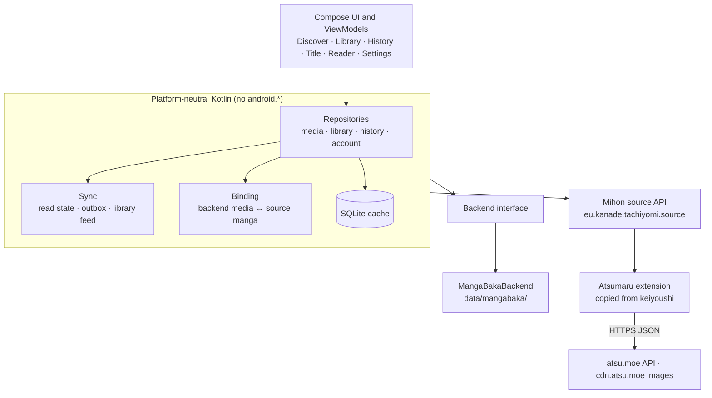

# Koma

## Why

Mihon is a full reader, but its library is local and trackers are attached afterwards: finding
something to read happens elsewhere, and the tracker is a sync target bolted onto each entry. Koma
inverts that. Koma is a client of one backend, MangaBaka, and that backend is the product surface:
the account, the library and the reading history are MangaBaka's. Discovery comes from MangaBaka's
trending, top-rated and popular lists, with its cross-site rating shown everywhere. Sources only
supply chapters and pages, through Mihon's extension API, so Mihon's extensions can supply them. v1
has one, Atsumaru, an aggregator whose titles carry their MangaBaka id. Reading a chapter updates
MangaBaka without a manual step. Koma is a personal Android app in Kotlin and Jetpack Compose.

- `[NG-1]` iOS, macOS, web, Linux and Windows builds in v1. Android is the only shipped host.
- `[NG-2]` A local library or local-only titles. A title exists in the app only through the
  backend library or a backend query.
- `[NG-6]` Anime, light novels, or any non-image content.
- `[NG-7]` Migrating an existing AniList list. MangaBaka's own AniList import does that once,
  outside Koma.

## Design

- `[PI-1]` Backend first. Every screen starts from a backend media; a source manga exists only as
  the content behind a backend media.
- `[PI-2.2]` Platform-neutral core. Everything above the `Backend` interface and Mihon's source API
  is Kotlin that imports no `android.*`. It must not know which site a source reads or that the
  backend is MangaBaka.
- `[PI-4]` Repositories own the data. Screens and ViewModels read and write only through
  repositories. A ViewModel holds only its screen's status, such as a request in flight or failed,
  and builds state with pure functions.

| Decision | Choice | Rationale |
| --- | --- | --- |
| `[KD-1.1]` Framework | Native Android: Kotlin and Jetpack Compose in one Gradle module, `app/`, with SQLite through SQLDelight | Android is the only host (`[KD-2.1]`), and Gradle builds it with no Rust, Hermes or wasm toolchain. |
| `[KD-2.1]` Host | Android only (`[NG-1]`) | Scope choice for a personal app. Only the UI and the platform seams depend on Android (`[PI-2.2]`). |
| `[KD-8.1]` Library | The backend library grouped by status, cached in SQLite. Read whole once through `changes(null)`, then kept current with a stored cursor. A refused cursor (`ExpiredCursorException`) triggers one full read. A backend without a changes feed refuses every cursor. | `[NG-2]`. The feed carries removals, so the cache never keeps a deleted entry. One member serves backends with and without a feed. |
| `[KD-31]` Library refresh | The library syncs, then updates its titles' chapters (`doc/architecture/specs/sources/sources.spec.md` `[CT-22]`), when the user pulls the Library down, when it first shows after a sign-in in this process, and while it was never synced. A launch over a synced library sends no request for it. | Mihon's model: a launch costs no request, and the user decides when the library and its chapters refresh. The first update after a sign-in fetches every title's chapters once. |
| `[KD-21]` Repositories | `MediaRepository`, `LibraryRepository`, `HistoryRepository` and `AccountRepository` in `app.koma.data`, one instance each, built by `AppContainer` (`[CT-10.4]`). Library and history sync run inside them. | Android's data-layer guidance: one repository per kind of data, over the network and the database. Any screen reuses the same data. |
| `[KD-22]` Backend name in copy | UI strings that name the backend read `Backend.name`. | Replacing the backend touches no screen. |
| `[KD-23]` Rating | The title screen's status button splits once the library holds the title: its trailing half shows the user's rating and opens a gauge from 0 to 5 in half points. 0 clears the rating. | MangaBaka rates out of 100 and stores 0 as none. Half points keep a drag along the gauge's arc precise. |
| `[KD-24]` Navigation | Navigation 3. Each tab keeps its own back stack of `@Serializable` routes, restored after process death. Another tab's stack shows over the Library's, so back from its root opens the Library, and back from the Library's root leaves the app. Each screen draws its own floating header. | Popped screens drop their ViewModels and saved state, and predictive back works at any depth. A shared header would need its own copy of `NavDisplay`'s transition. |
| `[KD-25.2]` Title colors | The first opening waits for the details and the final cover's color sample before showing the title's content. Its header and content use the final Material "Content" scheme immediately, without easing. Celebi and `Score` choose the seed from a 96 px copy. The seed, including a successful grey result, is stored alongside the details and reused across openings and restarts. A grey or missing cover, a failed image load, Monochrome, or the Theme page's Cover colors switch turned off keeps the app's colors; True Black still applies. Failed image loads are not cached as grey. | Waiting prevents both partial content and a palette change after reveal. Storing the seed avoids decoding and quantizing the cover again. |



## Outcome

- `[SO-2]` The Library tab is the signed-in user's MangaBaka library, grouped by status, and follows
  edits and removals made elsewhere. — demonstrated by `[VC-1.2]`, `[VC-8]`
- `[SO-3.2]` A title opens with its details and final cover colors ready, reusing both after a
  restart. — demonstrated by `[VC-15]`
- `[SO-8]` A user rates a library title from its screen, in half points from 0.5 to 5, or clears
  the rating. The rating is MangaBaka's and follows edits made elsewhere. — demonstrated by
  `[VC-14]`

## Contracts

### [CT-4.5] Local store

Kind: schema · Anchor: `app/src/main/sqldelight/app/koma/data/db/`

```sql
create table media (
  backend text not null, id text not null,
  title text not null, cover text not null, kind text not null,
  score real, adult integer not null, long_strip integer not null,
  primary key (backend, id)
);
create table media_details (
  backend text not null, id text not null, details text not null,
  color_cover text, color_seed integer,
  primary key (backend, id)
);
create table library_entry (
  backend text not null, media_id text not null,
  status text not null, progress real, updated_at integer not null, score real,
  primary key (backend, media_id)
);
create table read_event (
  backend text not null, id text not null, media_id text not null,
  at integer not null, from_chapter real, to_chapter real,
  primary key (backend, id)
);
create index read_event_at on read_event (at desc, id desc);
create table meta (key text primary key, value text not null);
```

`status` and `kind` hold enum names. `media` and `media_details` are public data kept across
sign-outs. `media_details.details` is the backend's JSON. A null `color_cover` means unsampled;
otherwise `color_seed` is the sampled ARGB, or null for a cover with no suitable color. A cached
sample is used only for the same cover URL. The additive migration preserves existing details;
their seeds are sampled on the next opening. An empty `media.title` marks media the backend no
longer answers, which screens leave out. `library_entry` mirrors the backend library and changes
only through `changes()` or a successful `addEntry` or `updateEntry`. `meta` holds the library and
history cursors and is cleared at sign-out with `library_entry` and `read_event`. A migration
converts stored scores to the 0.0–5.0 scale. `library_entry.score` is null when the user has not
rated the media. The migration that adds it drops the library cursor, so the next sync reads the
library whole and fills it in. Sources, the reader and Discover add their tables through additive
migrations (`doc/architecture/specs/sources/sources.spec.md` `[CT-13.1]`,
`doc/architecture/specs/reader.spec.md` `[CT-14]`, `doc/architecture/specs/discover.spec.md`
`[CT-15]`).

### [CT-10.4] Repositories

Kind: api · Anchor: `app/src/main/kotlin/app/koma/data/`

```kotlin
package app.koma.data

data class CoverColors(val cover: String, val seed: Int?)

class MediaRepository(store: Store, backend: Backend) {
    fun media(ref: MediaRef): Flow<Media?>                         // from the store
    fun details(ref: MediaRef): Flow<MediaDetails?>               // from the store
    suspend fun loadDetails(ref: MediaRef): MediaDetails           // fetches unless stored
    fun coverColors(ref: MediaRef): CoverColors?                  // null until sampled successfully
    suspend fun cacheCoverColors(ref: MediaRef, colors: CoverColors)
    suspend fun cache(refs: Collection<MediaRef>)                  // looks up refs not stored yet
}

data class LibraryItem(val media: Media, val status: ListStatus, val updatedAt: Long)
data class Library(val synced: Boolean, val items: List<LibraryItem>)

class LibraryRepository(store: Store, backend: Backend, media: MediaRepository, clock: Clock) {
    val library: Flow<Library>
    fun synced(): Boolean                                       // the library was read once
    fun entry(ref: MediaRef): Flow<ListEntry?>
    suspend fun sync()
    suspend fun setStatus(ref: MediaRef, status: ListStatus)
    suspend fun setScore(ref: MediaRef, score: Double)          // 0 clears the rating
}

data class Read(val id: String, val media: Media, val at: Long, val from: Double?, val to: Double)
data class History(val synced: Boolean, val reads: List<Read>, val hasNext: Boolean)

class HistoryRepository(store: Store, backend: Backend, media: MediaRepository) {
    val history: Flow<History>
    fun synced(): Boolean            // the first page is stored
    suspend fun syncNewer()
    suspend fun loadOlder()
}

class AccountRepository(store: Store, backend: Backend) {
    val backendName: String
    val sessions: StateFlow<Session>
    val signIns: Int                 // successful sign-ins in this process
    val userName: StateFlow<String?> // null until loaded; empty when the account has none
    suspend fun signIn(): SignInResult
    suspend fun signOut()
    suspend fun loadUserName()
}
```

`AppContainer` builds one of each from the `Backend` it is given, and exposes no `Store`, SQL or
`Backend` to features. Flows answer again after each store write. `Library.items` and
`History.reads` leave out media the backend no longer answers. `Library.items` lists media with a
stored read first, newest read first, then the others by their last update. `History.reads` holds
only events that raise progress. Grouping into shelves and hiding `Kind.Novel` are the library feature's pure
functions. A sync or write started before a sign-out drops what it fetched (`Store.generation`).
`setStatus` calls `addEntry` when the stored library lacks the media, else `updateEntry`, then
writes the store. When that call fails, it syncs the library, so a retry picks the member that
matches the backend. `setScore` calls `updateEntry(ref, score = score)` on media the library
holds, then writes the store, and syncs the same way when that call fails. `signOut` clears user
data before ending the session. `loadUserName` asks once per session and drops a reply for a
session that has ended. Koma calls it at launch, so a session MangaBaka no longer accepts ends
before a screen syncs; an offline launch keeps it.

Details, once stored, are never fetched again; they are public and kept across sign-outs.
The title waits for details and cover sampling, then reveals its content only once the palette
also applies to the header. A failed details request reveals the cached name and a retry action.
A failed cover request reveals the details with the app's colors and retries sampling on a later
opening. A successful sample persists even when grey; theme settings still determine the palette.
The history screen reads the first page on open while `synced` is false; newer events wait for a pull
to refresh, or for the library's sync.

## Acceptance

Tests run on the JVM under Robolectric. They stub MangaBaka's API and OAuth endpoints with
`FakeNetwork`, the test harness's OkHttp interceptor. The harness records image URLs and normally
returns image failures. Color tests supply bitmaps through its image-loader seam.

- `[VC-1.2]` Given a stub returning a library payload, when the Library tab opens, then its shelves
  match the stub's states, each lists titles with a stored read by their newest read and the others
  by their last update, and novels are left out. — demonstrates `[SO-2]`
- `[VC-8]` Given a synced library and a stored cursor, when the changes feed answers one upsert and
  one delete with `more: true` and then `more: false`, then Library shows the upsert, drops the
  deleted entry, issues no full library read, and stores the last cursor; when the stub refuses the
  cursor, one full read follows. — demonstrates `[SO-2]`
- `[VC-14]` Given a library entry with `rating: 87`, when its title screen opens, then the status
  button's rating half shows `4.4`; when the gauge moves to 3.5 and the rating is saved, the stub
  receives `PATCH /v1/my/library/{id}` with `rating: 70` and the half shows `3.5`; when the gauge
  moves to 0 instead, the stub receives `rating: 0` and the half offers to rate; when the stub
  answers 500, the half keeps the rating it showed. — demonstrates `[SO-8]`
- `[VC-15]` Given delayed details and then a delayed colored cover, when the title opens, only a
  loading indicator appears until both finish, and the first frame of its status button uses the
  final cover palette. Given successfully sampled colorful and grey covers, reopening each and
  restarting with unavailable images keeps its palette without waiting for sampling. A failed
  first sample does not prevent a later opening from using a successful sample.
  — demonstrates `[SO-3.2]`

## Caveats

- `[C-1.1]` Library versions follow Mihon's `gradle/libs.versions.toml`, so a set Mihon builds with
  is known to work together. Libraries Mihon does not use take their latest stable release.
