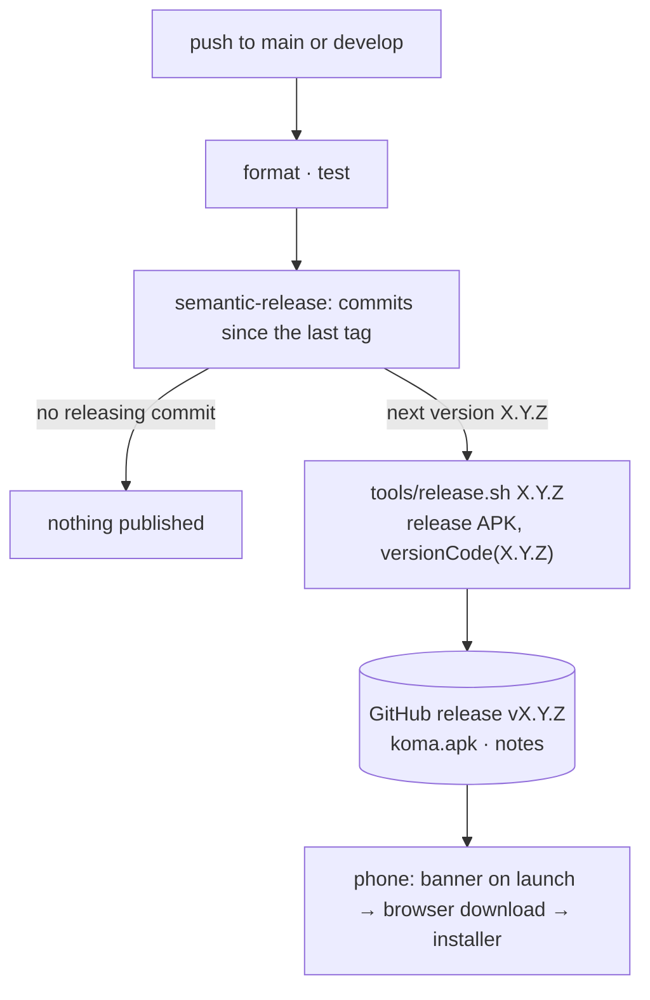

# Koma distribution

## Why

Koma ships outside Google Play, to one phone. Each change to the app should reach that phone
without building on a Mac or uploading by hand. Every change ships as a new release APK on GitHub
Releases, and the installed app offers to download it, as ReVanced Manager and Morphe Manager do.

- `[G-1]` Install Koma from one stable link, which always serves the newest APK.
- `[G-2]` An installed app says when a newer APK exists and downloads it on request.
- `[G-3]` Publishing needs no manual step after a push to `main`, or to `develop` for a beta.
- `[NG-1]` Google Play or any other store.
- `[NG-3]` Silent APK installs. Android's installer asks each time.
- ~~`[NG-4]` Distributing the web host, or builds of branches other than `main` and `develop`.~~
- `[NG-4.1]` Builds of branches other than `main` and `develop`.
- ~~`[NG-5]` Over-the-air updates of the Contract, assets or `app.ts`.~~
- `[NG-5.1]` Over-the-air updates. Every change ships as an APK.

## Design

- `[PI-1]` One link. `https://github.com/antoine-bouteiller/koma/releases/latest/download/koma.apk`
  always serves the newest APK.
- `[PI-2]` CI is the only publisher. The release keystore lives in CI secrets; local builds never
  publish.
- `[PI-3]` The installed binary is the only version. Its `versionName` is the release's semantic
  version and its `versionCode` derives from it.
- `[PI-4]` Commit messages decide releases. Conventional Commits drive semantic-release, as in
  `antoine-bouteiller/FanControl.LiquidCtl`.

| Decision | Choice | Rationale |
| --- | --- | --- |
| `[KD-1]` Host | GitHub Releases of the public `antoine-bouteiller/koma` repository. Each release is tagged `v<version>`, carries one asset, `koma.apk`, and semantic-release's notes. Releases from `develop` are prereleases (`1.2.0-beta.1`). | Free, no account beyond GitHub, a stable latest-asset URL, and an unauthenticated API the app can read. |
| ~~`[KD-3]` Update banner~~ | ~~When the latest stable release's `versionCode` exceeds the installed `exactDelivery().version`'s, every screen shows "Koma X.Y.Z is available." with a Download button that opens the release's `koma.apk` URL in the browser (`[CT-3]`).~~ | ~~Exact has no API to hand an APK to Android's installer. The browser downloads it, and tapping the download installs it.~~ |
| `[KD-3.1]` Update banner | When the latest stable release's `versionCode` exceeds the installed `BuildConfig.VERSION_NAME`'s, every screen shows "Koma X.Y.Z is available." with a Download button that opens the release's `koma.apk` URL in the browser (`[CT-3.1]`). | The browser downloads it, and tapping the download installs it, so the app needs no install permission. |
| ~~`[KD-4]` APK signing~~ | ~~One release upload keystore, used for every published APK: the keystore the AppDrop APKs used.~~ | ~~Android refuses to install over a different signer. Keeping it lets the AppDrop install update in place.~~ |
| `[KD-4.1]` APK signing | One release upload keystore, used for every published APK: the keystore the Exact APKs used. | Android refuses to install over a different signer, so every release keeps it. The AppDrop and Exact installs it updated in place are another application id, which `app.koma` does not replace. |
| `[KD-6]` When an APK is built | When semantic-release finds a releasing commit since the last tag: `feat` (minor), `fix` or `perf` (patch), `build(deps)` (patch), or a breaking change (minor, `[KD-13]`). Its `prepare` step runs `tools/release.sh`. | Every release is offered to the installed app, so `docs`, `ci`, `chore`, `refactor`, `style` and `test` commits must not prompt an install. |
| ~~`[KD-9]` Build number~~ | ~~`EXACT_VERSION` is the release version and `EXACT_BUILD_NUMBER` its `versionCode(version)` from `src/version.ts`: MAJOR·10⁶ + MINOR·10⁴ + PATCH·10² + the beta number, or 99 for a stable release. MINOR, PATCH and the beta number stay below 100.~~ | ~~Android installs over an APK only with a higher `versionCode`; a stable release outranks its betas. The first release, 0.1.0, is 10099, above every AppDrop APK.~~ |
| `[KD-9.1]` Build number | `app/build.gradle.kts` sets `versionName` from `KOMA_VERSION` (default `0.1.0`) and `versionCode` from `versionCode(versionName)` in `app/src/main/kotlin/app/koma/version/VersionCode.kt`, which `buildSrc` compiles too: MAJOR·10⁶ + MINOR·10⁴ + PATCH·10² + the beta number, or 99 for a stable release. MINOR, PATCH and the beta number stay below 100. | Android installs over an APK only with a higher `versionCode`; a stable release outranks its betas. One definition serves the build and the banner. |
| `[KD-10]` Trigger | A `publish` workflow on every push to `main` and `develop` and on manual dispatch, after its `format` and `test` jobs pass. A `develop` run fails unless `develop` contains `main`. Runs queue and are never cancelled. A release pushes only its tag, never a commit, so `develop` can be promoted to `main` by fast-forward and still contain it. Pull requests run `format`, `test` and `android` in a separate `check` workflow. | `[G-3]`, `[NG-4.1]`. A run cancelled mid-release can leave a tag without its APK. |
| ~~`[KD-11]` Check timing~~ | ~~The app asks GitHub once per launch, and only when `version` is set. A missing release (404) means nothing to offer, not a failure.~~ | ~~GitHub allows 60 unauthenticated requests per hour per IP. The web build sets `version` only from `EXACT_VERSION`, which the dev shell defaults to native's `0.1.0`.~~ |
| `[KD-11.1]` Check timing | The app asks GitHub once per launch. A missing release (404) means nothing to offer, not a failure. | GitHub allows 60 unauthenticated requests per hour per IP. |
| `[KD-12]` Commit convention | Conventional Commits, checked at `commit-msg` by commitlint with `@commitlint/config-conventional`, through the dev shell's git hooks. | A malformed message is a release semantic-release silently skips. |
| `[KD-13]` Version line | Releases stay at 0.x: tag `v0.0.0` on the root commit is the base, so the first release is `0.1.0`, and a breaking change bumps the minor version. Leaving 0.x is a deliberate edit of that rule in `.releaserc.json`. | Koma is a pre-1.0 personal app; semantic-release would otherwise start at `1.0.0` and turn every breaking change into a major. |



## Outcome

- `[SO-1]` The phone installs Koma from one stable GitHub Releases link, which serves the newest
  release-signed APK. — demonstrated by `[VC-1.1]`
- `[SO-2]` A push to `main` with a releasing commit publishes a new APK with a higher semantic
  version and `versionCode`, and the installed app offers it at its next launch; installing it
  takes the user's confirmation. — demonstrated by `[VC-1.1]`, `[VC-3.1]`
- `[SO-3]` A push whose commits are none of `feat`, `fix`, `perf`, `build(deps)` or a breaking
  change publishes nothing. — demonstrated by `[VC-2]`

## Contracts

### [CT-1.1] Build

Kind: config · Anchor: `app/build.gradle.kts`

~~`[CT-1]` Manifest~~: `app.json` is gone.

```kotlin
val komaVersion = System.getenv("KOMA_VERSION") ?: "0.1.0"
defaultConfig {
    applicationId = "app.koma"
    versionName = komaVersion
    versionCode = versionCode(komaVersion)
}
```

The APK links no update store (`[NG-5.1]`). A release build is signed by `KOMA_KEYSTORE` with
`KOMA_KEYSTORE_PASSWORD`, `KOMA_KEY_ALIAS` and `KOMA_KEY_PASSWORD`, else by the debug key.

### [CT-2.1] Publish job

Kind: boundary · Anchor: `.releaserc.json`

~~`[CT-2]` Publish job, with the `EXACT_*` build variables~~: the same job, with `KOMA_*` ones.

```yaml
# .github/workflows/publish.yml, job `publish`; secrets list the job's inputs
on: { push: { branches: [main, develop] }, workflow_dispatch: {} }
needs: [format, test]
permissions: { contents: write }
env:
  GITHUB_TOKEN: "${{ github.token }}"
  KOMA_KEYSTORE_PASSWORD: "${{ secrets.EXACT_KEYSTORE_PASSWORD }}"
  KOMA_KEY_ALIAS: "${{ secrets.EXACT_KEY_ALIAS }}"
  KOMA_KEY_PASSWORD: "${{ secrets.EXACT_KEY_PASSWORD }}"
secrets:
  EXACT_KEYSTORE_BASE64:    # release upload keystore, base64; written to a file named by KOMA_KEYSTORE
```

```sh
bun install --frozen-lockfile
bunx semantic-release   # branches: main, develop (prerelease "beta"); preset conventionalcommits
# prepare: tools/release.sh <version>; no commit: the tag is the version
# publish: GitHub release v<version> with koma.apk
```

```sh
# tools/release.sh <version>
KOMA_VERSION=<version> ./gradlew --no-daemon assembleRelease
cp app/build/outputs/apk/release/app-release.apk koma.apk
```

The keystore file is written under `$RUNNER_TEMP`, never into the workspace. A failed step fails
the job, and semantic-release creates no tag or release after a failed `prepare`. The secrets keep
their `EXACT_*` names; renaming them is a change in the repository settings.

### [CT-3.1] Update banner

Kind: api · Anchor: `app/src/main/kotlin/app/koma/update/`

~~`[CT-3]` Update banner, in `app.contract` and `app.ts`~~: the same behavior, in `update/`.

```kotlin
data class Release(val version: String, val url: String)   // url: the release's koma.apk

// GET /repos/antoine-bouteiller/koma/releases/latest (stable only), 10 s timeout.
// 404 → null; tag `v<V>` with asset koma.apk and versionCode(V) > versionCode(installed) → Release;
// otherwise null. Any other failure throws.
fun newerRelease(http: OkHttpClient, installed: String): Release?

fun bannerText(version: String): String  // "Koma 2.0.0 is available."

// Asks once, with BuildConfig.VERSION_NAME; a failure shows no banner and is not retried.
class UpdateViewModel(container: AppContainer) : ViewModel() { val release: StateFlow<Release?> }
```

`UpdateBanner` shows `update-banner` with `update-text` and an `update-now` button that opens the
release's URL in the browser.

### [CT-4] Publication invariants

Kind: invariant · Anchor: null

- Every published APK is signed by the release keystore, and its `versionCode` is higher than the
  one before.
- A release tagged `v<version>` carries an APK whose `versionName` is `<version>` and whose
  `versionCode` is `versionCode(<version>)`.

## Acceptance

`[VC-1.1]` and `[VC-2]` are manual qualifications against GitHub and a phone, which CI does not
have.

- ~~`[VC-1]` Given Koma installed from release `v4` or the AppDrop link, when the first push after
  this change runs `publish`, then release `v0.1.0` exists with `koma.apk` and notes, the
  latest-asset link serves it, and installing it replaces the earlier install without
  uninstalling. Given `v0.1.0` installed, when a `fix:` commit is pushed to `main`, then release
  `v0.1.1` appears, and the next launch shows "Koma 0.1.1 is available."; Download opens the
  browser on `v0.1.1`'s `koma.apk`.~~
- `[VC-1.1]` When the first push of the restarted history runs `publish`, then release `v0.1.0`
  exists with `koma.apk` and notes, it is the only release, the latest-asset link serves it, and
  installing it by hand adds `app.koma`. Given `v0.1.0` installed, when a `fix:` commit is pushed
  to `main`, then release `v0.1.1` appears, and the next launch shows "Koma 0.1.1 is available.";
  Download opens the browser on `v0.1.1`'s `koma.apk`, and installing it updates in place.
  — demonstrates `[SO-1]`, `[SO-2]`
- `[VC-2]` When a push to `main` carries only `docs:` and `ci:` commits, then the `publish` run
  ends with "There are no relevant changes, so no new version is released" and no release.
  — demonstrates `[SO-3]`
- ~~`[VC-3]` In `app.test.contract`, with `version` 0.1.0: a stubbed latest release `v2.0.0` with
  `koma.apk` shows `update-text` "Koma 2.0.0 is available." and holds that asset's URL; a stubbed
  `v0.1.0` shows no `update-banner`.~~
- `[VC-3.1]` In a Robolectric test with installed version 0.1.0: a stubbed latest release `v2.0.0`
  with `koma.apk` shows `update-text` "Koma 2.0.0 is available.", and `update-now` opens that
  asset's URL; a stubbed `v0.1.0` shows no `update-banner`. — demonstrates `[SO-2]`

## Caveats

- ~~`[C-1]` Not yet run: `publish` on a runner, and the banner on Android. Exact's native `fetch`
  is assumed to send the explicit `User-Agent` header GitHub requires. `[VC-1]` is the first run
  of both.~~
- `[C-1.1]` Not yet run: `publish` on a runner, and the banner on Android. OkHttp sends
  `User-Agent: koma`, which GitHub requires, on every request. `[VC-1.1]` is the first run of both.
- ~~`[C-2]` The AppDrop install (version 3) and release `v4` have no banner for semantic-version
  tags. Each moves to `v0.1.0` by one manual install, after which it updates in place.~~
- `[C-2.1]` The AppDrop and Exact installs (`io.github.antoinebouteiller.koma`) have no path to
  `app.koma`. Release `v0.1.0` is installed by hand beside them, and they are uninstalled by hand.
- ~~`[C-3]` Tests that do not stub GitHub reach the real API, because the dev shell sets
  `version`. They assert nothing about the banner, so a rate limit or a new release does not
  change their outcome.~~
- `[C-4]` The check runs at launch only. An app kept in the background sees a newer release at its
  next cold launch.
- `[C-5]` Losing the release keystore means uninstalling Koma before installing an APK signed by a
  new one. The keystore is kept outside the repository, in a password manager, as well as in CI
  secrets.
- `[C-6]` Anyone with the link can install Koma. Accepted for a personal app.
- `[C-7]` A beta install is offered only stable releases, since `releases/latest` skips
  prereleases. A newer beta is installed by hand from the Releases page.
