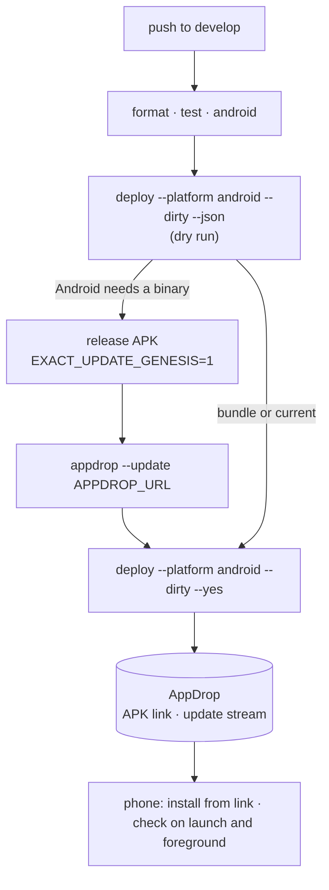

# Koma distribution

## Why

Koma ships outside Google Play, to one phone. Today an APK reaches it only when someone builds it
on a Mac and uploads it by hand, and every change, even a one-line view tweak, means downloading
and installing a new APK. Exact can update an installed app over the air for everything except a
new binary, and AppDrop can host both the APK and those updates without a server or an account.

- `[G-1]` Install Koma from one stable link and its QR code, which always serves the newest
  binary.
- `[G-2]` Changes that need no new binary reach an installed app without reinstalling, and the app
  offers to apply them.
- `[G-3]` Publishing needs no manual step after a push to the default branch.
- `[NG-1]` Google Play or any other store.
- `[NG-2]` Telling the user that a newer APK exists. A new binary is installed by hand from the
  link.
- `[NG-3]` Silent APK installs.
- `[NG-4]` Distributing the web host, or builds of branches other than the default one.

## Design

- `[PI-1]` One link. The AppDrop link always serves the APK of the newest update stream; a fresh
  install catches up over the air.
- `[PI-2]` CI is the only publisher. The release keystore and the update key live in CI secrets;
  local builds never publish.
- `[PI-3]` Exact's defaults over configuration.

| Decision | Choice | Rationale |
| --- | --- | --- |
| `[KD-1]` Host | AppDrop, for the APK (one link, updated with `--update`) and for the update streams (the `"appdrop"` channel) | No server or account. GitHub Actions artifacts expire, are zipped and need a GitHub login; Releases would need the private repository made public. |
| `[KD-2]` Update policy | Exact's defaults: `activate` `next-launch` and `check.interval` 900 s. No `deploy.activate` or `deploy.check` key in `app.json`. | Simplest. A check runs when the app comes to the foreground (at most once a minute) and every 15 minutes while it stays there, never in the background. |
| `[KD-3]` Update banner | While `exactDelivery().staged` is true, the screen shows "An update is ready." with an Update button that calls `deliveryActivate()` (`[CT-3]`). | Applies an update before the next launch on request; without a tap it applies at the next cold launch anyway. |
| `[KD-4]` APK signing | One release upload keystore, used for every published APK. The debug-signed link `https://appdrop.app/d/r38ttinp9d` is retired. | AppDrop refuses an update whose signer changed (`android_signer_changed`), and Android refuses to install over a different signer. |
| `[KD-5]` Link creation | By hand, once: the first release-signed APK is uploaded without `--update`. Its share link becomes the `APPDROP_URL` variable and its update key the `APPDROP_MANAGE_KEY` secret. CI only ever updates that link. | The update key appears only in the creating command's output; CI logs must never hold it. |
| `[KD-6]` When a new APK is built | Only when `deploy`'s dry run classifies Android as needing a binary: no stream yet, or native inputs or the compatibility id changed (a new grant, a new Exact, a new update key). Otherwise CI publishes a signed bundle only. | Most changes need no binary, so the link and its build number change only when installing is required. |
| `[KD-7]` Stream start | A new APK is built with `EXACT_UPDATE_GENESIS=1`, starting its stream at sequence zero, and `deploy --yes` runs right after it in the same job. | A fresh runner has no release record to pass as `EXACT_UPDATE_RECEIPT`. `deploy` reads the APK's production build receipt from the job's bake output, starts the stream from it, and leaves the stream head at the APK's own commit. |
| `[KD-8]` Publication order | Upload the APK, then `deploy --yes`. | If `deploy` fails after the upload, the next run finds no stream and builds the APK again. The reverse order would leave a stream on AppDrop whose APK never reached the link, and later runs would see no need for a binary. |
| `[KD-9]` Build number | `EXACT_BUILD_NUMBER` is the link's published `version` from `GET https://appdrop.app/api/drops/<id>`, plus one. | AppDrop refuses a reused `versionCode`. Exact's own `share` reads the same endpoint for the same reason. Survives workflow renames that reset `github.run_number`. |
| `[KD-10]` Trigger | A `publish` job on pushes to the default branch (`develop`), after `format`, `test` and `android` pass. | `[G-3]`, `[NG-4]`. |



## Outcome

- `[SO-1]` The phone installs Koma from one AppDrop link and QR code, which serves the newest
  release-signed APK. — demonstrated by `[VC-1]`, `[VC-2]`
- `[SO-2]` A push that changes only the view, the data module or `assets/` reaches the installed
  app at its next launch, and an in-app banner offers to apply it sooner. — demonstrated by
  `[VC-1]`, `[VC-3]`
- `[SO-3]` A push that needs a new binary publishes a new APK to the same link with a higher build
  number; installing it is manual. — demonstrated by `[VC-2]`

## Contracts

### [CT-1] Manifest

Kind: config · Anchor: null

```json
{
  "deploy": {
    "store": { "web": "0", "android": "A" },
    "channels": { "prod": "appdrop" },
    "signing": { "key": "koma", "keys": { "koma": "<Ed25519 public key, base64>" } }
  }
}
```

`"A"` links Android's update store into the APK. The public key is baked into every APK and is
part of the compatibility id, so replacing it needs a new APK (`[KD-6]`). The private half is
created with `bun ../exact/scripts/deploy.mjs keygen koma` and never enters the repository.

### [CT-2] Publish job

Kind: boundary · Anchor: null

```yaml
# .github/workflows/ci.yml, job `publish`; secrets and vars list the job's inputs
if: github.ref == format('refs/heads/{0}', github.event.repository.default_branch)
needs: [format, test, android]
secrets:
  EXACT_KEYSTORE_BASE64:    # release upload keystore, base64; written to a file named by EXACT_KEYSTORE
  EXACT_KEYSTORE_PASSWORD:
  EXACT_KEY_ALIAS:
  EXACT_KEY_PASSWORD:
  EXACT_SIGNING_KEY:        # koma.pem, written into the directory EXACT_SIGNING_KEY_DIR names
  APPDROP_MANAGE_KEY:       # read by the appdrop CLI from the environment
vars:
  APPDROP_URL:              # the share link from [KD-5]
```

```sh
bun exact.mjs deploy --platform android --dirty --json > plan.json
# when plan.json has a row with kind "binary" and platform "android":
EXACT_UPDATE_TRUST=production EXACT_UPDATE_GENESIS=1 EXACT_BUILD_NUMBER=<[KD-9]> \
  bun exact.mjs android --release --no-install --json
bunx appdrop@0.9.0 target/android/app/outputs/apk/release/app-release.apk --update "$APPDROP_URL" --json
# always:
bun exact.mjs deploy --platform android --dirty --yes
```

`--dirty` is required, not a choice: Exact refuses to publish an app outside its own checkout
without it, because ignored files such as `.exact/` count as source. The CI tree is a clean
checkout. Secret files are written under `$RUNNER_TEMP` and never into the workspace. A failed
step fails the job and publishes nothing after it; the next run repeats the classification.

### [CT-3] Update banner

Kind: api · Anchor: null

```contract
shape Delivery
  staged: bool

resource delivery = exactDelivery() as shape Delivery
action update
  deliveryActivate()

if delivery.staged
  row testId="update-banner"
    text "An update is ready." flex=1
    button press=update testId="update-now"
      text "Update"
```

The web host has no update store, so `staged` is always false there. `deliveryActivate()` waits
for requests in flight and gestures to end before applying.

### [CT-4] Publication invariants

Kind: invariant · Anchor: null

- Every APK on the link is signed by the release keystore, and its `versionCode` is higher than the
  one before.
- After a successful `publish` run, the Android stream head is the run's commit, and the APK on the
  link belongs to that stream.

## Acceptance

`[VC-1]` and `[VC-2]` are manual qualifications against the live link and a phone: they depend on
AppDrop and a device, which CI does not have.

- `[VC-1]` Given Koma installed from `APPDROP_URL` and showing `Koma is running.`, when a push to
  `develop` changes only that text in `app.ts`, then AppDrop's `version` for the link is unchanged,
  the run's `deploy` table publishes one Android bundle, the app shows `update-banner` after its
  next return to the foreground, and tapping `update-now` shows the new text. — demonstrates
  `[SO-1]`, `[SO-2]`
- `[VC-2]` Given the same install, when a push adds a grant line to `app.ts`, then the link's
  `version` rises by one, the installed app never shows `update-banner`, and an install from the
  link shows the pushed text. — demonstrates `[SO-1]`, `[SO-3]`
- `[VC-3]` On the web host, the first screen has no `update-banner`
  (`expect tree missing "update-banner"` in `app.test.contract`). — demonstrates `[SO-2]`

## Caveats

- `[C-1]` Not yet run: `deploy` on a fresh runner reading the stream state back from AppDrop, and
  starting a stream from the APK built earlier in the same job (`[KD-7]`). `[VC-1]` and `[VC-2]`
  are the first runs of both.
- `[C-2]` Exact's documents disagree on whether an Android update carries `app.ts`: the
  over-the-air recipe says it does, `app.schema.json`'s `deploy.store` says signed TypeScript
  delivery is not implemented. `[VC-1]` changes only `app.ts` to settle it. If it fails, data-module
  changes need a new APK and `[KD-6]` classifies them so.
- `[C-3]` `GET /api/drops/<id>` is undocumented in AppDrop's README. Exact's `scripts/share.mjs`
  depends on it the same way.
- `[C-4]` An APK from an older stream gets no updates and no prompt (`[NG-2]`); it is replaced by
  installing from the link. Most features in `app.spec.md` add a grant, so until they land most
  pushes need a reinstall. A later prompt can compare `exactDelivery().buildNumber` with the link's
  `version`.
- `[C-5]` Losing the release keystore means a new link and uninstalling Koma first. Losing the
  update key means a new APK before any further update. Both are kept outside the repository, in a
  password manager, as well as in CI secrets.
- `[C-6]` Anyone with the link can install Koma. Accepted for a personal app.
